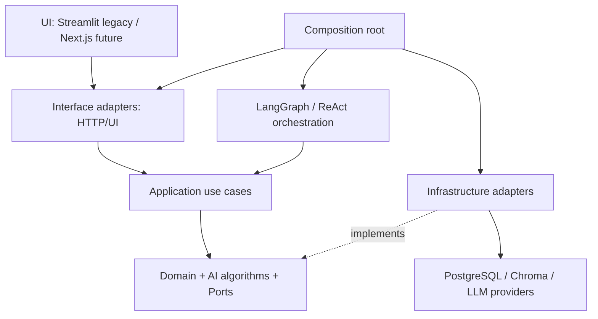

# SELF STUDY SUPPORTER — PHASE 0: ENGINEERING FOUNDATION & CORE ISOLATION PREPARATION

> **Vai trò:** AI Lead / Senior AI Engineer / Tech Lead  
> **Trạng thái:** Implementation-ready plan — **chưa triển khai các task trong tài liệu**  
> **Ngày lập:** 2026-10-13  
> **Repository:** https://github.com/ManhT005/self-study_supporter  
> **Baseline cần kiểm tra:** `main` tại `cb67b95d890fc90eff98df1960d68384e48c99b7` (23/08/2026)  
> **Nhánh Docker đang có:** `feature/docker-local-foundation`, HEAD khi review `0cf9524e52455e3b75d2b8cd781ddd4300b1e085`  
> **Phạm vi:** P0 của AI Research Master Plan; chuẩn bị cho UI Next.js, FastAPI, LangGraph, Adaptive RAG và v1.0.0  
> **Ước lượng:** 7–12 ngày làm việc cho 2 developer, phụ thuộc Docker/runtime và trạng thái dữ liệu hiện có. Không phải cam kết thời gian.

---

## 0. Quyết định điều hành

**Bước đầu tiên KHÔNG phải triển khai LangGraph hay thay toàn bộ UI.** Chúng ta phải có một nền móng để mỗi PR sau này an toàn và có thể đánh giá độc lập.

**Deliverable của Phase 0:**

1. Docker Compose chạy được **legacy Streamlit + PostgreSQL + persistent Chroma** trên máy người phát triển, có smoke evidence và hướng dẫn backup/restore.
2. Một package Python mới **`study_supporter`** theo `src-layout` được xây dựng, cài đặt và kiểm thử độc lập khỏi Streamlit, SQLAlchemy và LangGraph — **mới chuyển một vertical slice nhỏ**, không big-bang rewrite.
3. Ranh giới **Domain / Application / AI Algorithms / Orchestration / Infrastructure / Interface** được ghi thành ADR + import gate.
4. Baseline unit/integration/regression tests và CI green, phát hiện được vấn đề đa người dùng, quiz parser, tài liệu rỗng, cấu hình provider, restart persistence.
5. README, Python dependencies, `.env` templates, docs, branch policy được chuẩn hóa. Release v1.0.0 **chưa** được gắn tag ở Phase 0.

**Không coi số lượng thư mục là thước đo kiến trúc.** Mọi package phải có trách nhiệm rõ ràng, dependency direction được kiểm tra và use case có test.

### 0.1. Ranh giới P0 và các giai đoạn sau

| Hạng mục | P0 (làm ngay) | P1+ (không làm trong P0) |
|---|---|---|
| Docker | Harden Compose legacy, persistence, smoke, docs | Web/API/worker production stack |
| Python | `pyproject.toml`, package skeleton, một core slice + adapter | Di chuyển toàn bộ module hiện có |
| RAG | Kiểm thử baseline và edge-case P0; **không đổi thuật toán** | Rerank, contextual/hierarchical/graph retrieval |
| Agent | Giữ ReAct legacy có contract + mocked tests | LangGraph graphs / native tool calling |
| UX | Khóa API contract, legacy UI chỉ hotfix an toàn | Next.js redesign |
| DB | Xác định schema, migration baseline, backup policy | Data model lớn cho mastery / courses |
| CI | Lint, unit, import gate, build smoke | Heavy LLM benchmark / GPU jobs |

### 0.2. Nguyên tắc tránh regressions

- Mọi công việc thuộc P0 phải duy trì luồng **đăng ký → đăng nhập → upload PDF → index → chat → quiz → lưu tiến độ → đăng xuất → đăng nhập lại**.
- Không đẩy thay đổi trực tiếp lên `main`; dùng các PR nhỏ, dễ rollback.
- Không dùng `from src...` trong **package mới**; chỉ giữ import `src.*` trong legacy code hoặc compatibility adapter trong giai đoạn chuyển đổi.
- Không thay đổi embedder/model, kích thước vector, collection name hoặc data schema mà không có migration/compatibility test.
- Các hoạt động có side effect (ghi DB, Chroma, file, gọi model) nằm sau port/interface; không xảy ra khi import module.
- Không bắt frontend chờ backend: mock và OpenAPI contract là đầu ra của Phase 0.

---

## 1. Audit hiện trạng đã đối chiếu với source

| Khu vực | Hiện trạng quan sát | Tác động với P0 | Mức độ |
|---|---|---|---|
| `main.py` | Streamlit entrypoint, state & UI composition; nhánh Docker đã bỏ in `DATABASE_URL` | Giữ entrypoint tạm thời, tách bootstrap sau | P0 |
| `ui/components/sidebar.py` | Một file >500 dòng làm upload, parse, embed, Chroma, BM25, graph, providers, orchestrator | Đây là dependency hotspot; **không** di chuyển đồng loạt | P0 |
| `src/rag/*` | Parser, semantic chunking, BM25, RRF, Chroma + providers ở chung | Thiết kế ports để thay backend mà không sửa algorithm | P0 |
| `src/agent/orchestrator.py` | Custom text ReAct + regex JSON tool call | Lưu làm baseline; không refactor cùng PR Docker | P1 |
| `src/memory/*` | SQL `ProgressDB`, Chroma user_memory, ShortTermMemory | Tách contracts và đảm bảo user context | P0 |
| `ui/components/quiz_arena.py` | Quiz lấy 5 chunk đầu; fallback đáp án đầu khi không parse đúng | Fix correctness trước công bố cho user | P0/P1 |
| `src/rag/chunker.py` | `np.percentile` trên distances không có guard rỗng | Phải test PDF rỗng / 0-1 câu | P0 |
| `src/db/*` | SQLAlchemy `create_all()` từ import modules, chưa có Alembic | Migration baseline, tránh side effect startup | P0 |
| `src/db/models.py` | `User.id` integer; `QuizAttempt.user_id` string | Ghi nhận và chuẩn hóa trong migration có kiểm soát; không sửa kiểu trực tiếp | P0 |
| `eval_test.py` | Tool constructors thiếu tham số `user_id` | Sửa script sau khi có smoke tests; không đưa vào mandatory PR check trước fix | P0 |
| `tests/*` | Test ReAct và `eval_rag.py` rỗng; coverage thấp ở security/integration | Tạo baseline ngoài model network | P0 |
| `Dockerfile`, `compose.yaml` | Có trên branch Docker; chạy Streamlit + Postgres; Ollama optional | **Chưa có Docker runtime/E2E evidence** | P0 |
| `requirements.txt` | Không pin version, import `numpy` không khai báo trực tiếp | Chốt Python, lock dependency, tách runtime/test deps | P0 |
| `.env.example` | Có endpoint Supabase mẫu cũ và key placeholders | Chuẩn hóa template không dùng connection string cụ thể | P0 |

**Chú ý:** bảng là kết quả **static review**, không tuyên bố bug nào đã tái hiện trên Docker thực. Nhánh Docker được commit nhưng chưa được build, run và test end-to-end trong môi trường ở thời điểm lập plan.

### 1.1. Những điểm phải sửa trước khi chuyển kiến trúc

**BLOCKER A — Quyền riêng tư / session isolation**  
Kiểm tra việc logout có xóa `vector_store`, `store`, `bm25_index`, `embed_query_fn`, `current_document_id`, `graph_source_chunks`, `quiz_history`, `pending_prompt`, `current_sources`, session user identity, v.v. Không chỉ clear một vài khóa; ưu tiên whitelist state giữ lại vô hại (theme) hoặc reset toàn bộ session. **Test A logout → B login trong cùng browser** và xác thực mọi document/service fetch bằng `user_id` phía server.

**BLOCKER B — Quiz correctness**  
Không cho phép `_parse_quiz_from_text` tự mặc định `correct_index = 0` khi thiếu marker hợp lệ. Nếu parse lỗi → fail closed / regenerate có giới hạn. Structured JSON `QuizQuestion` là contract dài hạn; ở P0 ít nhất phải loại bỏ silent incorrect scoring.

**BLOCKER C — Empty/small document**  
`compute_breakpoints()` phải xử lý `distances=[]`; PDF scan/text rỗng cần trạng thái unsupported/needs OCR, không báo READY giả. Test file PDF 0 câu / 1 câu / lỗi.

**BLOCKER D — Data migration**  
Không chạy `Base.metadata.create_all()` thay cho migration trong production. Thiết kế Alembic baseline cho **DB trống**, kịch bản upgrade DB đã tồn tại phải có backup + schema inspection, không tự `stamp` nếu chưa chứng minh giống revision.

---

## 2. Target repo structure — modular monolith, Python src-layout

**Mô hình đích sau P1/P2 (không phải cấu trúc phải tạo đầy đủ trong P0):**

```text
self-study_supporter/
├── apps/
│   ├── web/                          # Next.js (UI phase, chưa tạo P0)
│   └── streamlit_legacy/             # Streamlit adapter (chuyển sau khi có contract)
│       └── main.py
├── backend/
│   ├── pyproject.toml                # Một Python distribution: study-supporter
│   ├── src/
│   │   └── study_supporter/
│   │       ├── __init__.py
│   │       ├── config.py             # Typed settings (không import Streamlit)
│   │       ├── domain/               # Thuần Python: entities, rules, errors
│   │       │   ├── documents/
│   │       │   └── learning/
│   │       ├── application/          # Use cases và DTOs; không biết HTTP/UI
│   │       │   ├── contracts/
│   │       │   ├── ports/            # DB, object store, vector, LLM, clock...
│   │       │   └── use_cases/
│   │       ├── ai/                   # Thuật toán thuần, ít phụ thuộc
│   │       │   ├── ingestion/        # Parse/chunk pipeline
│   │       │   ├── retrieval/        # BM25, RRF, rerank future
│   │       │   ├── graph/            # Concept graph, prerequisites
│   │       │   ├── assessment/       # Quiz schema/validation
│   │       │   ├── learning/         # Mastery, review scheduling future
│   │       │   └── memory/           # Memory policy, không tự kết nối DB
│   │       ├── orchestration/
│   │       │   ├── legacy_react/     # Custom ReAct baseline, adapter
│   │       │   └── langgraph/        # Để dành P3, KHÔNG tạo placeholder tràn lan
│   │       ├── infrastructure/       # Adapters cho ports
│   │       │   ├── persistence/      # SQLAlchemy/Alembic integration
│   │       │   ├── vectors/          # Chroma adapter
│   │       │   ├── providers/        # Ollama/Gemini/OpenAI-compatible
│   │       │   ├── storage/          # Local/S3 upload future
│   │       │   └── jobs/             # Queue adapters future
│   │       ├── interfaces/
│   │       │   ├── http/             # FastAPI routers, later
│   │       │   └── cli/              # Migrations/eval/smoke future
│   │       └── bootstrap.py          # Composition root/DI
│   ├── tests/
│   │   ├── unit/
│   │   ├── integration/
│   │   ├── contract/
│   │   └── fixtures/
│   └── migrations/                 # Alembic
├── evaluation/
│   ├── datasets/                   # Gold labels, không có dữ liệu cá nhân
│   ├── runners/                    # Reproducible benchmarks
│   └── reports/                    # Evaluation results + environment metadata
├── deploy/
│   ├── docker/                     # Dockerfiles khi tách app/api/worker
│   └── env/                        # Chỉ .example, không secrets
├── docs/
│   ├── architecture/
│   │   ├── overview.md
│   │   ├── module-boundaries.md
│   │   ├── data-lifecycle.md
│   │   └── adr/
│   ├── plans/
│   ├── operations/
│   └── api/
├── scripts/                        # Smoke, backup, data repair (reviewed)
├── .github/workflows/
├── compose.yaml                     # Dev orchestration hiện tại
├── .env.docker.example
├── .dockerignore
├── .gitignore
├── README.md
├── CONTRIBUTING.md
└── LICENSE                         # Khi chủ dự án xác định license
```

**P0 transitional tree** (chỉ thêm mức tối thiểu, **không đổi chỗ legacy**):

```text
self-study_supporter/
├── main.py                          # GIỮ legacy chạy được
├── src/                             # GIỮ legacy code, chưa rename
├── ui/                              # GIỮ Streamlit UI
├── backend/
│   ├── pyproject.toml
│   ├── src/study_supporter/
│   │   ├── __init__.py
│   │   ├── domain/__init__.py
│   │   ├── application/{contracts,ports,use_cases}/
│   │   ├── ai/retrieval/             # 1 pure component chuyển đầu tiên
│   │   ├── infrastructure/__init__.py
│   │   └── bootstrap.py
│   └── tests/{unit,contract}/
├── docs/architecture/{overview.md,module-boundaries.md,adr/}
├── docs/plans/PHASE_0_ENGINEERING_FOUNDATION.md
├── .github/workflows/quality.yml
├── Dockerfile
├── compose.yaml
└── .env.docker.example
```

### 2.1. Architectural dependency rule — phải enforce trong CI



**Lưu ý chiều mũi tên:** dependency được inject tại composition root; module business **không import ngược** driver hoặc UI. Sơ đồ cho thấy quan hệ sử dụng, còn luật import dưới đây là tiêu chí kiểm tra bắt buộc.

```text
User / Browser
   ↓
UI (Streamlit legacy / Next.js future) → Application API (FastAPI future)
                                          ↓
                                  Application Use Cases
                                          ↓
                         Domain + AI Algorithms + Ports
                                          ↑
                                Infrastructure Adapters

Orchestration (Custom ReAct now / LangGraph later)
    → calls application use cases / AI ports via injected dependencies
```

**Import rules:**

- `domain` KHÔNG import `streamlit`, `fastapi`, `langgraph`, `langchain`, `sqlalchemy`, `chromadb`, `requests`.
- `application` KHÔNG import UI, database implementation, model SDK cụ thể; chỉ phụ thuộc `domain`, `ai` (thuần), `ports`, `contracts`.
- `ai` thuật toán KHÔNG kết nối network hoặc tự mở DB; embedding/LLM/sparse/vector qua ports.
- `infrastructure` implement ports, có thể import driver/SDK, không lật chiều phụ thuộc.
- `orchestration` giữ graph state và workflow; **KHÔNG viết lại business rules** và KHÔNG trực tiếp sử dụng Streamlit session.
- `interfaces` là adapter nhập: authenticate, validate, gọi application, serialize response.
- `bootstrap` / composition root nối các implementation; các module còn lại không tự instantiate provider ở import-time.

### 2.2. ADR cần lập ngay

- **ADR-0001:** Modular monolith, không microservices trước v1.
- **ADR-0002:** Python `src-layout`, `study_supporter` import root, single distribution.
- **ADR-0003:** LangGraph ở orchestration layer; AI Core không phụ thuộc LangGraph.
- **ADR-0004:** PostgreSQL là nguồn sự thật của user/document/quiz, Chroma lưu vector; ID scope chuẩn.
- **ADR-0005:** Docker local baseline trước UI/API split, persistent volumes và Ollama optional.
- **ADR-0006:** Reproducible experiments; mọi cải tiến RAG có baseline, dataset và measurement.

---

## 3. File mapping — làm sao từ cấu trúc cũ sang mới

| File hiện tại | Đích trong kiến trúc mới | Phase chuyển | Điều kiện |
|---|---|---|---|
| `src/rag/hybrid_retriever.py` | `ai/retrieval/hybrid.py` | **P0 vertical slice** | Pure RRF + contract tests; Chroma gọi qua port |
| `src/rag/bm25_index.py` | `ai/retrieval/bm25.py` | P1 | Giữ output baseline; tokenizer upgrade sau benchmark |
| `src/rag/chunker.py` | `ai/ingestion/chunking.py` | P1 | Test boundaries, empty distance, source/page metadata |
| `src/rag/pdf_parser.py` | `ai/ingestion/parsers/pdf.py` hoặc infra parser adapter | P1 | Parser result structured; không phụ thuộc UI |
| `src/rag/vector_store.py` | `infrastructure/vectors/chroma.py` | P1 | VectorStorePort; ownership/document scoped |
| `src/rag/embedding_provider.py` | `application/ports/embedding.py` + `infrastructure/providers/embedding/` | P1 | Model ID, dimension, timeout/error typed |
| `src/llm/*` | `application/ports/llm.py` + `infrastructure/providers/llm/` | P1 | Không đổi model ở migration |
| `src/agent/orchestrator.py` | `orchestration/legacy_react/runner.py` | P1 | ReAct baseline tests pass |
| `src/agent/tools/*` | `application/use_cases` + orchestration tool adapters | P1 | Tool output structured; side effects behind ports |
| `src/graph/*` | `ai/graph/*` | P1 | Cycle, invalid edge, topological tests |
| `src/memory/progress_db.py` | `infrastructure/persistence/repos/progress.py` | P1 | Query ownership, DB-backed test |
| `src/memory/long_term.py` | `ai/memory/policy.py` + `infrastructure/vectors/memory.py` | P1 | user_id required; no cross-user retrieval |
| `src/db/*` | `infrastructure/persistence/models.py`, repos | P1 | Alembic + data migrations reviewed |
| `src/documents/document_service.py` | `application/use_cases/documents.py` + repository adapter | P1 | Transactions, retry, status transitions |
| `ui/components/sidebar.py` | UI components + API/application orchestration | P1–P2 | Legacy ingestion parity test before removal |
| `src/eval/*` | `evaluation/*` | P2 | Offline eval reproducible |

**Điểm quan trọng:** file mapping là **lộ trình**, không phải ticket “move files hàng loạt”. Trong P0 chuyển thuật toán RRF thành hàm thuần và expose qua adapter, tạo bằng chứng dependency gates hoạt động; phần còn lại chuyển sau.

### 3.1. Contract đầu tiên (định nghĩa, chưa implement)

```python
from dataclasses import dataclass, field
from typing import Protocol, Sequence

@dataclass(frozen=True)
class RetrievalQuery:
    user_id: str
    document_ids: tuple[str, ...]
    question: str
    top_k: int = 5

@dataclass(frozen=True)
class Evidence:
    chunk_id: str
    document_id: str
    text: str
    source: str
    page_start: int | None
    page_end: int | None
    score: float | None = None

# Khi implement dùng validation (vd dataclass.__post_init__/Pydantic):
# user_id phải được xác thực, top_k >= 1, document_ids thuộc user.
# Không nhận user_id trực tiếp từ tool call / LLM.

class RetrieverPort(Protocol):
    def retrieve(self, query: RetrievalQuery) -> Sequence[Evidence]: ...

class EmbeddingPort(Protocol):
    @property
    def model_id(self) -> str: ...
    @property
    def dimension(self) -> int: ...
    def embed_documents(self, texts: Sequence[str]) -> list[list[float]]: ...
    def embed_query(self, text: str) -> list[float]: ...
```

Quy tắc: `user_id` **do authenticated context cung cấp**, không tin user_id do LLM hoặc frontend tự khai. `Evidence` không dùng ORM model; source metadata và chunk_id phải truy ngược được tới đúng document. Port/interface phải có semantic về lỗi, timeout và ranh giới transaction (bổ sung P1).

### 3.2. Phần UI & LangGraph sẽ gắn vào như thế nào

- **Next.js** gọi `FastAPI` thông qua DTO/OpenAPI, không import Python Core.
- **LangGraph TutorGraph** gọi `RetrieveEvidenceUseCase` và `AnswerQuestionUseCase`, không cầm trực tiếp `chromadb.Collection` hay DB session.
- **LangGraph QuizGraph** gọi `GenerateQuizUseCase` (structured question + evidence ID) và `RecordQuizAttemptUseCase` có idempotency key.
- **LangGraph PlannerGraph** đọc `LearningProgressPort` + `PrerequisiteGraphPort`; không lưu kế hoạch chỉ ở checkpoint.
- Checkpoints phục vụ resume workflow; PostgreSQL application DB vẫn lưu kết quả nghiệp vụ. Không lưu hoặc hiển thị raw Chain-of-Thought.

---

## 4. Detailed execution backlog — 6 PR nhỏ, có thể review độc lập

### PR-00 — Freeze baseline / establish evidence (1 ngày)

**Branch:** `chore/p0-baseline-audit` từ `feature/docker-local-foundation` nếu nhánh Docker chưa merge.  
**Owner:** AI Lead + Test Lead.

**Tasks:**

- [ ] Chụp baseline commit SHA, Python version, Docker Desktop version, environment flags (không lưu secret).
- [ ] Lập bảng behaviors hiện tại và sample fixture: PDF 1 trang text, 2 trang text, PDF blank, quiz valid/invalid, user A/B.
- [ ] Chạy `python -m pytest -q` với kết quả thật; lưu baseline pass/fail/blocked, không nói “green” nếu chưa chạy.
- [ ] Danh mục file hiện tại, call graph tạm: UI → sidebar → RAG/DB/LLM.
- [ ] Chốt ADR-0001..0006, protected branch + PR review checklist.

**Acceptance:** một file `docs/architecture/current-state.md` có command, environment, failures, dữ liệu test đã loại PII; danh sách quyết định có owner.

### PR-01 — Docker reproducibility / local developer experience (1–2 ngày)

**Branch:** `fix/p0-docker-validation` (có thể triển khai trực tiếp bằng PR tiếp nối nhánh foundation).  
**Owner:** System/Backend Engineer.

**Tasks:**

- [ ] Run `docker compose --env-file .env.docker config --quiet`; nếu lỗi, sửa Compose trước.
- [ ] Clean build trên Windows + Docker Desktop WSL: `up -d --build`, `ps`, `/ _stcore/health` (bỏ khoảng trắng khi gọi), log app.
- [ ] Kiểm tra DB readiness, create user, upload PDF, Chroma writes, restart app, down/up giữ state. Kiểm tra những tài liệu ở Chroma bị mất/gãy link với Postgres.
- [ ] Chạy Ollama host mode qua `host.docker.internal`, rồi optional profile local-ai; không bắt buộc chạy GPU trong P0.
- [ ] Viết README PowerShell/Unix shell, thời gian tải model dự kiến biến thiên, disk/RAM policy; model tải vào `hf_cache`, Chroma vào `app_data`, PG vào `postgres_data`.
- [ ] Harden env: `POSTGRES_PASSWORD` bắt buộc; username/password URL escaping hoặc dùng typed DB config + SQLAlchemy `URL.create()`; bỏ URL chứa host thật ở `.env.example`.
- [ ] Test secrets không vào image layers/git history; không log DB URL (nếu cần log chỉ host/db name đã redacted).
- [ ] Thử backup và restore riêng PostgreSQL + Chroma đồng bộ; tài liệu chỉ cách tránh `down -v`.
- [ ] Không mặc định kéo/pull model local trong Docker build; runtime provision riêng.
- [ ] Kiểm tra runtime không phải root, quyền file volume, CPU/RAM, healthcheck; có log evidence.
- [ ] Chốt dependencies từ clean install (pin phiên bản được test, bổ sung `numpy`, `pytest`, `ruff` phù hợp).

**Acceptance:** Docker chạy sạch với config mẫu (không key cloud), app+db healthy, user flow tối thiểu pass, data giữ sau restart; có báo cáo lỗi nếu model/Ollama chưa sẵn sàng; không hard-code GPU/cloud.

**Failure policy:** Nếu build fail vì Torch/Chroma/CPU, không thay cả framework; cố định phiên bản tương thích, tách smoke “boot without embedding” và full ingestion check.

### PR-02 — Python package scaffold & architecture gates (1–2 ngày)

**Branch:** `refactor/p0-python-package-foundation`.  
**Owner:** AI Engineer.

**Tasks:**

- [ ] Tạo `backend/pyproject.toml` (metadata, runtime group, dev optional extras, pytest, Ruff, type-check policy).
- [ ] Tạo `backend/src/study_supporter` theo **transitional tree** ở mục 2; không tạo dozens empty folders/`__init__.py` nếu chưa có mã.
- [ ] `pip install -e ./backend` hoạt động trong `.venv` và trong CI; `python -c "import study_supporter"` pass.
- [ ] Chuyển **pure RRF function** sang `study_supporter.ai.retrieval.rrf` và tạo legacy forwarder tương thích API `reciprocal_rank_fusion`; **không sửa ranking semantics**.
- [ ] Test RRF với duplicate ranks, empty input, stable ranking, top_k boundary.
- [ ] Thêm import guard: domain/application/ai không import Streamlit/FastAPI/LangGraph/SQLAlchemy/Chroma/HTTP client; kiểm tra bằng AST hoặc `import-linter`.
- [ ] Ghi ADR + README module ownership; không sử dụng `sys.path.append` để “lách” import.
- [ ] Chỉnh Docker `COPY`/install **sau khi xác minh package build**, đảm bảo legacy imports vẫn chạy (không thay Compose trước khi PR-01 xanh).

**Acceptance:** package cài/import được, gate phát hiện một test import sai (negative test), RRF output giống bản cũ trên golden vectors.

### PR-03 — Reliability, security & correctness guardrails (2 ngày)

**Branch:** `fix/p0-correctness-and-session-isolation`.  
**Owner:** Backend + Test Lead.

**Tasks:**

- [ ] Lập `reset_session_on_logout()` và xóa state user-scoped; test logout/login khác tài khoản cùng browser.
- [ ] Tất cả read/write document/notes/quiz phải được scope theo user trong repo/service; không dựa vào collection name do frontend gửi.
- [ ] Fix empty distances, empty/single-sentence PDF, bad MIME/size validation và tempfile cleanup `finally`.
- [ ] Quiz missing/ambiguous correct answer → validation error (không chọn A mặc định); không ghi attempt lỗi.
- [ ] Chỉ hiển thị citation từ `Evidence` thực có `document_id/chunk_id/page`; không mặc định “Uploaded PDF / Knowledge graph / Progress notes”.
- [ ] Quản lý lỗi typed: `DocumentUnsupported`, `EmbeddingUnavailable`, `EvidenceNotFound`, `QuotaExceeded`; UI map sang thông báo rõ ràng, log không lộ PII/key.
- [ ] Add regression tests cho upload/quiz/chat/graph; mọi fix phải có test tái hiện trước hoặc kèm theo.

**Acceptance:** tất cả P0 blockers ở mục 1.1 được test; user B không thể xem bất kỳ user A data, quiz parser fail closed, ingestion empty không báo READY.

### PR-04 — Database lifecycle & migration baseline (1–2 ngày)

**Branch:** `feature/p0-db-migrations`.  
**Owner:** Backend/System Engineer.

**Tasks:**

- [ ] Chốt schema source of truth: User, Document, QuizAttempt; chỉ thay cột khi có migration và backfill.
- [ ] Thêm Alembic (định vị trong `backend/migrations/`); initial revision cho **fresh PostgreSQL**.
- [ ] Test upgrade fresh DB to head, consistency FKs, composite query by authenticated `user_id`, downgrade policy rõ ràng.
- [ ] Đối với DB đã có dữ liệu: backup, schema diff, manual approval trước `stamp` hoặc migrate; **không tự động stamp**.
- [ ] Thống nhất cách khởi tạo schema: app boot không âm thầm tạo tables từ import side effects sau khi baseline đã được nghiệm thu; migration chạy trước khi app start.
- [ ] Seed chỉ bằng fixture/dev script, tuyệt đối không seed account bí mật mặc định vào môi trường public.

**Acceptance:** migrate DB trống pass; upgrade test DB có sample dữ liệu không làm mất rows; rollback plan/backup được ghi lại. Không claim hỗ trợ upgrade mọi schema Supabase cũ nếu chưa kiểm chứng.

### PR-05 — Quality gates & developer documentation (1–2 ngày)

**Branch:** `ci/p0-quality-gates`.  
**Owner:** Test Lead + AI Lead.

**Tasks:**

- [ ] `.github/workflows/quality.yml`: `ruff check`, `ruff format --check`, fast offline unit tests, package install/import, import-architecture gate; separate PostgreSQL integration job.
- [ ] `docker compose config` + Docker image build job có cache/budget; GPU/LLM calls KHÔNG nằm trong mandatory PR tests.
- [ ] Mock model/provider, fake retriever, tmp Chroma/PDF fixture; test không sử dụng cloud key.
- [ ] Tạo `CONTRIBUTING.md`, PR template, CODEOWNERS (nếu đội có quy ước), command matrix Windows/Linux.
- [ ] Chỉnh README: tên sản phẩm nhất quán, clone URL đúng, capabilities đã implement vs proposed, Docker quickstart, link docs, kiến trúc, screenshot minh họa (nếu có quyền sử dụng).
- [ ] `docs/architecture/current-state.md`, `overview.md`, `module-boundaries.md`, ADRs, `docs/operations/docker.md`.
- [ ] Chạy full PR review checklist và ghi báo cáo `docs/reports/p0-acceptance.md` với logs/test numbers thật.

**Acceptance:** CI `quality` xanh trên PR, test không phụ thuộc API key/GPU, Docker smoke đã được con người kiểm chứng, toàn bộ docs khớp source.

### 4.0.1. `pyproject.toml` skeleton tham khảo cho PR-02

Chỉ là cấu hình **mẫu định hướng**, phiên bản công cụ thực tế cần chốt bằng clean install và lock sau PR-01:

```toml
[build-system]
requires = ["setuptools>=75", "wheel"]
build-backend = "setuptools.build_meta"

[project]
name = "study-supporter"
version = "0.0.0"
requires-python = ">=3.11,<3.13"
dependencies = []  # Bổ sung runtime dependencies theo use case thật, không nhân đôi legacy requirements

[project.optional-dependencies]
dev = ["pytest", "ruff"]

[tool.setuptools.packages.find]
where = ["src"]

[tool.pytest.ini_options]
testpaths = ["tests"]
```

Không cài toàn bộ `torch`, `chromadb`, `langgraph` vào `domain` hoặc `ai` thuần chỉ vì chúng đang ở `requirements.txt` legacy. Khi chuyển module cụ thể, khai báo dependencies đúng nhóm và tạo lock cho deployment; không trộn dependency thử nghiệm vào image release.

### 4.1. Phân công gợi ý cho nhóm 2 người

| Người | Trách nhiệm chính | Có thể chạy song song |
|---|---|---|
| Engineer A (AI/Backend) | Contract, package scaffold, RRF port, architecture gate, RAG/quiz regression | PR-02, một phần PR-03 |
| Engineer B (System/Full-stack) | Docker, DB, security/session, CI, devex | PR-01, PR-04, PR-05 |
| AI Lead/Test Lead (vai trò review) | ADR, baseline, acceptance, API review, fixture/eval | Cross review mỗi PR |

**Dependency:** PR-00 → PR-01 → PR-02. PR-03 có thể mở sớm nhưng merge sau khi Docker baseline đã được lưu. PR-04/PR-05 có thể phát triển song song với PR-02 nhưng cần rebase và chỉ merge khi CI sạch. Không tranh chấp cùng `main.py`, `ui/components/sidebar.py` trên hai PR cùng lúc.

---

## 5. Test strategy — Definition of Done có thể chạy

### 5.1. Bắt buộc unit (không internet, không GPU, không API key)

```text
backend/tests/unit/test_rrf.py
backend/tests/unit/test_retrieval_contract.py
backend/tests/unit/test_quiz_validation.py
backend/tests/unit/test_chunking_edge_cases.py
backend/tests/unit/test_concept_graph.py
backend/tests/unit/test_provider_errors.py
backend/tests/unit/test_session_reset.py
backend/tests/contract/test_import_boundaries.py
```

**Test cụ thể:**

1. RRF merge list dense/sparse có duplicate ID, tie-breaking deterministic, empty result.
2. RetrievalQuery `top_k <= 0` bị reject theo contract; không cho hỏi tài liệu của user khác.
3. Quiz options không đúng 4, `correct_answer_index` ngoài 0–3 hoặc thiếu giá trị đều fail closed.
4. 0/1/2 câu và empty distances không làm crash chunker; source metadata đúng trang.
5. Graph cycle returns explicit status, invalid edges không tạo nodes không có provenance.
6. Provider 429/timeouts không che lỗi authentication; fallback được log redacted.
7. Logout clear tất cả user-scoped states; không dùng lại `orchestrator`/Chroma collection khi đổi tài khoản.
8. Negative import-gate: cố tình import `sqlalchemy` trong `domain` → test fail.

### 5.2. Integration (isolated PostgreSQL, temp Chroma, fake embeddings)

```text
backend/tests/integration/test_documents_repository.py
backend/tests/integration/test_upload_index_restore.py
backend/tests/integration/test_user_isolation.py
backend/tests/integration/test_migrations.py
```

- User A upload tài liệu A, user B không query/tìm được A; yêu cầu thiếu ownership trả `403/404` theo contract thống nhất (ưu tiên 404 tránh tiết lộ sự tồn tại).
- Document lifecycle: `PROCESSING → READY | FAILED`, retry sau crash không tạo bản trùng (idempotency, tối thiểu design + test nơi đã implement).
- Postgres metadata trỏ collection Chroma tồn tại; restart vẫn retrieval được.
- Quy trình tạo DB schema qua Alembic, không phụ thuộc thứ tự import.
- Không gọi embedding provider online trong integration suite.

### 5.3. End-to-end smoke — trên máy Docker thực

| Test ID | Các bước | Expected |
|---|---|---|
| SM-01 | `docker compose config --quiet` | Exit 0 |
| SM-02 | `up -d --build` / health | DB `healthy`; Streamlit health 200 |
| SM-03 | Register + login | User record lưu PostgreSQL |
| SM-04 | Upload 1-page text PDF | READY; chunk_count >0; query trả evidence |
| SM-05 | Quiz valid + answer | Correct result persisted |
| SM-06 | Restart `app`, `db` | User/quiz/Chroma remain intact |
| SM-07 | User A logout / B login | B không thấy data A |
| SM-08 | Empty/scan PDF | FAILED/unsupported có thông báo; không READY giả |
| SM-09 | Ollama host/profile | `/api/tags` hợp lệ; nếu dùng chat, model đã pull |
| SM-10 | Backup + restore test trên môi trường thử | Không mất referential integrity |

**Lưu ý:** `/_stcore/health` cho biết Streamlit server sống, **không** chứng minh DB/embedding/LLM đều sẵn sàng; cần readiness/functional smoke riêng. Nếu Ollama chưa được provision, mark `SKIPPED` có lý do, không suy ra `PASS`.

### 5.4. Quality gates

- Fast pytest phải xanh; không “skip all” bằng cách thiếu dependency.
- `ruff check` & `ruff format --check` xanh trong những file touched/new; legacy lint có thể baseline-ignore tạm và phải có lộ trình siết dần.
- Architecture import gate xanh; không đường import từ Core → UI/framework DB.
- CI Docker build (không cần download embedding weights / no GPU) xanh.
- Integration & smoke scripts cung cấp logs đã redacted.
- Documentation command đúng shell và kết quả có thể tái lập.
- Không được merge nếu có blocker correctness/privacy/migration chưa có test.

---

## 6. Developer setup và commands chuẩn

### 6.1. Local Windows PowerShell — từ branch Docker hiện có

```powershell
git fetch origin
git switch feature/docker-local-foundation
Copy-Item .env.docker.example .env.docker
# Edit .env.docker, thay POSTGRES_PASSWORD bằng mật khẩu riêng URL-safe.
docker compose --env-file .env.docker config --quiet
docker compose --env-file .env.docker up -d --build
docker compose --env-file .env.docker ps
docker compose --env-file .env.docker logs --tail=100 app
```

Mở `http://localhost:8501`. Nếu cấu hình Ollama trên Windows, kiểm tra `OLLAMA_BASE_URL=http://host.docker.internal:11434` và khả năng lắng nghe từ Docker; không mở listener ra mạng công cộng. Nếu dùng profile Docker Ollama, đổi URL sang `http://ollama:11434` và `docker compose --env-file .env.docker --profile local-ai up -d`.

### 6.2. Python package (sau PR-02)

```powershell
python -m venv .venv
.\.venv\Scripts\Activate.ps1
python -m pip install -e ".\backend[dev]"
python -m pytest backend/tests/unit backend/tests/contract -q
python -m ruff check backend
python -m ruff format --check backend
python -c "import study_supporter; print('package import ok')"
```

Câu lệnh `pip install -e ".\backend[dev]"` **chỉ chạy sau khi** `backend/pyproject.toml` thực sự được thêm với optional extra `dev`. Không sửa `PYTHONPATH` thủ công để bypass packaging.

### 6.3. Không xóa nhầm dữ liệu

- `docker compose down` giữ named volumes, **`down -v` xóa volumes**.
- Back up cả PostgreSQL **và** Chroma; không chỉ sao lưu DB quan hệ.
- Docker cache/model weights có thể lớn; xem `docker system df` trước khi prune.
- Cẩn thận credential PostgreSQL: Compose env vars có thể được đọc bởi người có quyền Docker/host; không xem env file là secret manager production.

---

## 7. Branching, merge strategy, rollback

**Integration rule:**

```text
main (stable baseline)
  └── feature/docker-local-foundation (đã có)
       ├── chore/p0-baseline-audit
       ├── fix/p0-docker-validation
       ├── refactor/p0-python-package-foundation
       ├── fix/p0-correctness-and-session-isolation
       ├── feature/p0-db-migrations
       └── ci/p0-quality-gates
```

**Cách merge khuyến nghị:** dùng một integration branch `phase/p0-engineering-foundation` được tạo từ nhánh Docker khi có bằng chứng Docker foundation chạy được. PR độc lập vào integration branch theo thứ tự; cuối P0 mở một PR duy nhất vào `develop` nếu repository chọn `develop`, hoặc `main` nếu chưa có `develop`. **Không tự tạo branch `develop` chỉ vì thói quen.**

**Rollback:**

- Docker PR: revert Compose/Dockerfile commit và `docker compose down` (không `-v`); volumes vẫn còn.
- Package PR: legacy import forwarder giữ đường cũ; revert code facade nếu smoke fail.
- DB PR: backup snapshot trước migrate, rollback bằng restore ở môi trường staging khi migration không an toàn; không tin `alembic downgrade` luôn khôi phục dữ liệu.
- Security PR: nếu thay đổi auth/session làm người dùng không truy cập được, rollback code nhưng **không xóa dữ liệu**; mọi thay đổi ownership phải test cross-user.

**PR template tối thiểu:** mục tiêu, phạm vi, ảnh hưởng schema, test run + output, Docker evidence, risk, rollback steps, ADR link, migration required?, security notes.

---

## 8. Acceptance review — sign-off trước khi sang P1

| ID | Bắt buộc | Evidence yêu cầu | Gate |
|---|---|---|---|
| G-01 | Docker boot sạch | `config`, `ps`, log, health và app render | BLOCK |
| G-02 | Persistent state | Restart giữ user, quiz, document metadata, Chroma | BLOCK |
| G-03 | User isolation | A/B tests cả logout và repository access | BLOCK |
| G-04 | Quiz + empty PDF correctness | Offline unit + Docker smoke nếu phù hợp | BLOCK |
| G-05 | New package import & architecture | `pip install -e ./backend`, import gate | BLOCK |
| G-06 | Alembic baseline | DB sạch; DB có dữ liệu thử; migration review | BLOCK |
| G-07 | CI quality | Lint/unit/contract/integration + Docker build | BLOCK |
| G-08 | Developer docs | Fresh clone setup theo README | BLOCK |
| G-09 | No secrets, no UI/Core coupling | Review logs, `git diff`, architecture scan | BLOCK |
| G-10 | Baseline perf record | P50 ingest/chat trên 2 fixtures nếu có model; nếu unavailable ghi `BLOCKED` | INFORMATIONAL |

**Điều kiện tuyên bố “Phase 0 hoàn thành”:** tất cả G-01 đến G-09 PASS, có evidence và PR links, blocker được đóng, baseline SHA được ghi lại. Không dùng chữ “production-ready” hoặc “release v1.0.0” chỉ vì CI xanh. Không phải yêu cầu 100% code coverage — tập trung test tại các đường nguy hiểm.

### 8.1. Handoff chuẩn cho các nhóm tiếp theo

**Frontend team nhận:** `docs/api/` chứa OpenAPI contract dự kiến (auth / courses / documents / chat streams / quiz / progress), event schema UI-safe; fixtures + mock server; không import `src.rag`.

**LangGraph team nhận:** `RetrieverPort`, `EmbeddingPort`, `LLMPort`, `LearningProgressPort` (một số mới ở design/spec, implement ở P1); `Evidence` DTO; contract lỗi; yêu cầu idempotency & checkpoint namespace theo user/thread.

**RAG research team nhận:** baseline dense/hybrid, non-personal golden fixtures, evaluation runner thuần CLI, truy xuất không phụ thuộc Streamlit; kết quả benchmark lưu model ID, embedding dimension, corpus hash, runtime environment.

**System/Release team nhận:** Docker reproducible instructions, môi trường cấu hình tách biệt, migrations, volume backup, healthcheck, smoke scripts.

---

### 8.2. Risk register P0

| Risk | Probability / Impact | Cách giảm thiểu | Trigger để dừng merge |
|---|---|---|---|
| Docker image phình rất lớn vì Torch/SentenceTransformers | High / Medium | Model cache volume, build smoke không tải weights, pin deps | Disk/OOM khiến clean build fail |
| Schema mismatch giữa DB cũ và Alembic | Medium / Critical | Backup, inspect metadata, migration rehearsal, không auto-stamp | Mất rows/FK hoặc migration destructive |
| Rò state giữa nhiều user Streamlit | Medium / Critical | Session reset/ownership tests; server-side authorization | B thấy A documents/chat/quiz |
| Refactor gây import vòng hoặc module bootstrap tải model ngay | Medium / High | Ports, composition root, import gate, no network on import | Fast tests cần Ollama/API key/GPU |
| Chroma/PostgreSQL không đồng bộ sau crash | Medium / High | Lifecycle status, idempotency, verification on restore | READY nhưng vector missing |
| Thêm LangGraph quá sớm, trùng business logic | High / Medium | Freeze contracts P0, làm workflow sau P1 | LangGraph node truy cập DB/Chroma trực tiếp |
| Branch conflict UI, Docker, Core | Medium / Medium | Branch ownership, một integration branch, small PR | Cùng một file hotspot bị thay ở nhiều branch |

## 9. Task board rút gọn — có thể chuyển thành GitHub Issues

| Task | PR | Priority | Dependency | Done when |
|---|---|---|---|---|
| P0-001 Baseline report | PR-00 | P0 | none | Reproducible baseline documented |
| P0-002 Docker config/build | PR-01 | P0 | P0-001 | Clean build + health |
| P0-003 PG/Chroma persist | PR-01 | P0 | P0-002 | Restart/retrieve verified |
| P0-004 Ollama host/profile | PR-01 | P1 | P0-002 | Connectivity tested or documented skip |
| P0-005 Dependency lock/env | PR-01 | P0 | P0-002 | Reproducible install, no secrets |
| P0-006 Package skeleton | PR-02 | P0 | P0-001 | Editable install passes |
| P0-007 RRF vertical slice | PR-02 | P0 | P0-006 | Parity unit tests |
| P0-008 Architecture gate | PR-02 | P0 | P0-006 | CI-negative import test |
| P0-009 Session reset/ownership | PR-03 | P0 | P0-001 | Cross-user regression pass |
| P0-010 Quiz validation | PR-03 | P0 | P0-001 | Invalid quiz can't be scored |
| P0-011 Empty PDF + tempfiles | PR-03 | P0 | P0-001 | Structured fail / cleanup |
| P0-012 DB Alembic baseline | PR-04 | P0 | P0-001 | Clean DB migration succeeds |
| P0-013 Existing DB migration review | PR-04 | P0 | P0-012 | Data-preserving rehearsal |
| P0-014 CI workflows | PR-05 | P0 | PR-02/03/04 | Quality jobs green |
| P0-015 Documentation/ADR/PR template | PR-05 | P0 | PR-00 | Fresh clone setup passes |
| P0-016 P0 acceptance report | PR-05 | P0 | All | G-01..G-09 evidence |

---

## 10. Explicit non-goals — tránh scope creep

- Chưa tích hợp full LangChain/LangGraph, multi-agent, self-RAG, CRAG, RAPTOR, LightRAG.
- Chưa nâng cấp chiến lược chunking, embedding model hoặc vector database; không chạy reindex hàng loạt.
- Chưa chuyển hết Streamlit sang Next.js, chưa làm lại các sketch UI trong P0.
- Chưa tách microservices hay thêm Redis/Celery/Temporal chỉ để “chuẩn doanh nghiệp”.
- Chưa mở public port cho PostgreSQL/Ollama; chưa phát hành Docker/GHCR production image.
- Chưa đặt tag `v1.0.0`; chưa tuyên bố đạt benchmark mà không có dataset/evidence.

---

## 11. Recommended continuation after Phase 0

1. **Phase 1 — Core Extraction:** tách các use case document ingestion → retrieval → chat → quiz/progress theo ports; FastAPI minimal với auth và streaming contract.
2. **Phase 2 — RAG Benchmark:** Dense vs Hybrid vs +reranker; evaluate; chọn hướng contextual/graph retrieval có số liệu.
3. **Phase 3 — LangGraph Orchestration:** Tutor/Quiz/Planner subgraphs; checkpoints; deterministic validation; LangChain adapters.
4. **Phase 4 — UI Workspace:** Next.js từ sketch, mobile first, SSE UI events, source citations.
5. **Phase 5 — Personalization & Release:** mastery, review scheduler, eval/report, E2E, security, backups, v1.0.0 gate.

> **Quyết định cuối cùng của AI Lead:** Phase 0 phải biến repository thành một nền tảng **có thể build, test, rollback, mở rộng**, chứ không được tiêu tốn sprint vào việc đổi tên thư mục. Xong P0, mỗi nghiên cứu RAG hay Agent mới phải chỉ cần thêm component và benchmark, không kéo theo sửa toàn UI/database.

---

## 12. Tài liệu liên quan và tham chiếu kỹ thuật

### Nội bộ dự án

- [Repository `main`](https://github.com/ManhT005/self-study_supporter/tree/main)
- [Nhánh Docker Foundation](https://github.com/ManhT005/self-study_supporter/tree/feature/docker-local-foundation)
- [Docker local instructions](https://github.com/ManhT005/self-study_supporter/blob/feature/docker-local-foundation/docs/docker-local-foundation.md)
- `SELF_STUDY_SUPPORTER_AI_RESEARCH_V1_PLAN.md` — AI research roadmap (tài liệu nghiên cứu đã tạo trong cuộc trao đổi trước)
- `SELF_STUDY_SUPPORTER_UI_UX_V1_MASTER_PLAN.md` — UI/UX architecture & contracts (tài liệu đã tạo trong cuộc trao đổi trước)

### Public authoritative references

- [Python Packaging Guide — src layout vs flat](https://packaging.python.org/en/latest/discussions/src-layout-vs-flat-layout/)
- [Python Packaging Guide — pyproject.toml](https://packaging.python.org/en/latest/guides/writing-pyproject-toml/)
- [Docker Compose — control startup order & service_healthy](https://docs.docker.com/compose/how-tos/startup-order/)
- [Docker Compose specification — services](https://docs.docker.com/reference/compose-file/services/)
- [LangGraph — durable execution, replay & idempotency](https://docs.langchain.com/oss/python/langgraph/durable-execution)

**End of plan.**
