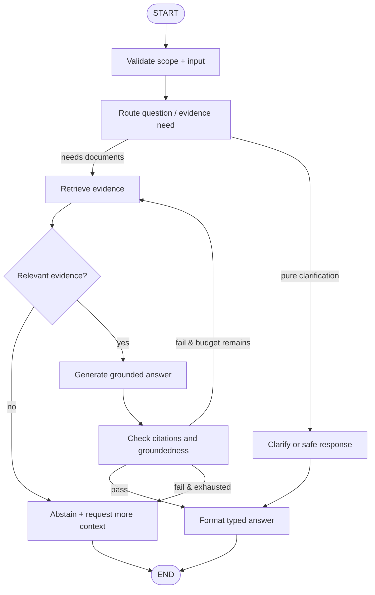
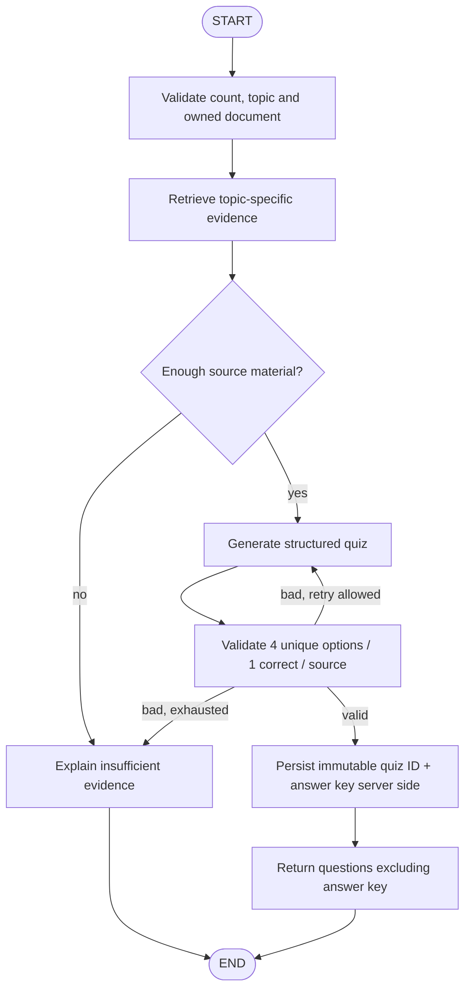
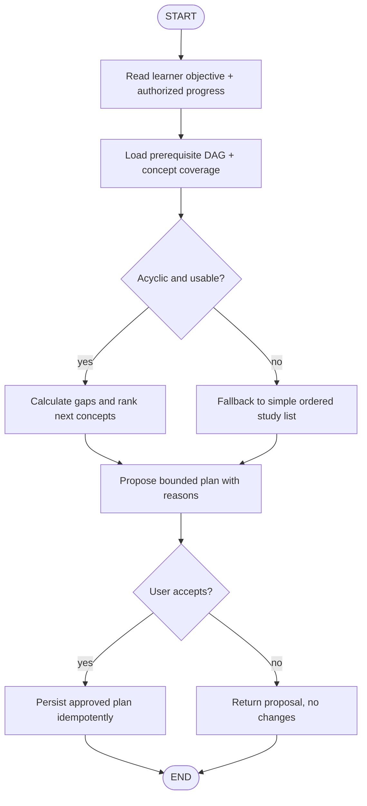

# Phase 3 — LangGraph Core: Tutor, Quiz, Planner

**Estimate:** 2–3 weeks · **Prerequisite:** Phase 2 typed tool adapters + benchmark.
**Goal:** An explicit graph of bounded business workflows, not three autonomous bots chatting with each other.

## 1. Design decisions

- One **top-level intent router** dispatches to Tutor / Quiz / Planner subgraphs, with a deterministic route override when frontend clearly states the task (e.g. quiz button).
- Nodes are single-responsibility; their inputs/outputs are typed. Conditional edges and retries are explicit. Every graph can reach `END` through normal, abstain or typed failure states.
- `AppContext` (authenticated user + active document set) is immutable and server-injected, not asked from the LLM. Only owned documents enter retrieval nodes.
- Separate ephemeral **per-request graph state** from persistent **per-thread checkpoint** and **long-term learner profile**. In this phase, graph state can be in-memory for deterministic tests; Phase 5 supplies durable saver.
- No reasoning or hidden thought in UI. Expose `safe_activity` records such as `search_started`, `evidence_found`, `quiz_validated`, `plan_proposed`, with no prompt/tool secrets.
- Align with currently installed API/SDK versions by spike and locked tests before implementation: https://docs.langchain.com/oss/python/langgraph/overview .

## 2. State schema (proposed)

```python
class LearningGraphState(TypedDict, total=False):
    request_id: str
    thread_id: str
    intent: Literal["tutor", "quiz", "planner"]
    question: str
    active_document_ids: tuple[str, ...]  # confirmed-owned IDs
    evidence: list[EvidenceDTO]             # typed, bounded and provenance-backed
    answer: str | None
    quiz: QuizSetDTO | None
    plan: LearningPlanDTO | None
    concept_ids: list[str]
    progress_snapshot_version: str | None
    attempts: int                          # bounded retry counter
    errors: list[SafeErrorDTO]
    activities: list[SafeActivityDTO]
    status: Literal["running", "complete", "abstained", "needs_approval", "failed"]
```

Authenticated identity should live in protected invocation configuration/context, not in model messages or mutable model-controlled state. Avoid storing large PDF chunks, provider keys, SQL sessions, locks or unserializable objects in checkpoints. Store reference IDs and hashes where possible; revalidate ownership on resume.

**Proposed DTOs:** `QuizSetDTO {quiz_id, document_ids, source_chunk_ids, questions[...], version}`, `LearningPlanDTO {plan_id, target, steps[{concept_id, prerequisite_ids, rationale, evidence_ids, status}], needs_approval}`; standard `AgentResult` wraps either type. `correct_answer_index` **must not be sent to the browser until grading/feedback rules allow disclosure**. Existing quiz contract is the authoritative core, so perform migration by adapter not schema reset.

## 3. Tutor Graph



**Tutor-specific rules:** enforce max retrieval attempts `≤2`, generation attempts `≤2`, total 45s configurable, top-k cap and per-user budget; avoid meaningless second retrieval if query is unchanged. No answer that claims a citation not in `evidence`. In Tutor MVP, concept graph may suggest related topics but is not a source of factual truth.

**Tutor test matrix:** valid single document, relevant multi-page, ambiguous question, no hits, conflicting chunks, prompt-injected PDF, owned vs foreign docs, provider unavailable, grader uncertain, repeated reranking, deadline exhausted.

## 4. Quiz Graph



Current quiz creation can select early chunks. **Upgrade must first retrieve by topic, not by “first five chunks.”** Validate `num_questions` `1..15`, options exactly 4, distinct nonempty choices, `correct_answer_index ∈ {0,1,2,3}`, nontrivial explanation, accessible source provenance. De-duplicate semantically similar questions and score via deterministic backend grading, not LLM opinion.

Submission is a **separate idempotent use case**: `quiz_id + authenticated user + submission_key` uniquely identifies a grading attempt. Handle browser retry without duplicate persisted attempts. A completed quiz updates progress; mastery updates must remain versioned/traceable and not infer high confidence from one item.

**Quiz tests:** zero evidence, incomplete JSON, wrong number of options, ambiguous answer, duplicate answers, hallucinated support, repeated submission, account A/B, session restart, client-forged correct answer.

## 5. Planner Graph



**Planner algorithm MVP:** For each concept `c`, compute explainable priority using `prerequisite_ready(c)`, `1 - mastery(c)`, recency, importance / coverage and learner time budget. Gate by unlearned prerequisites; suggest one next step and a small plan, not a fabricated calendar. `Mastery` confidence and stale/missing evidence must be visible. Use deterministic ranking first; add LLM only to formulate explanations **from computed data**.

**Proposed score for experiment** (not a validated learning science model): `score(c) = 0.4*(1-mastery) + 0.25*urgency + 0.2*importance + 0.15*review_due`, only for prerequisite-ready nodes, with explicit missing-value defaults. Calibrate after quiz data; compare to static chronological baseline. Graph cycles are handled via existing `detect_cycles` rather than silently scheduling impossible prerequisites.

**Planner tests:** missing mastery, no attempts, cyclic graph, failed graph extraction, no eligible nodes, conflicting user objectives, accepted plan duplicated, foreign progress, course abstraction not yet persisted, plan version conflict.

## 6. Implementation PR sequence

| Task | Work item | Files to add/touch | Gate |
|---|---|---|---|
| LG-01 | Architecture spike/ADR; pin LangGraph API and typed state | `docs/architecture/adr/*`, `requirements/*` | representative graph offline test |
| LG-02 | Add orchestrator router and graph contracts | `orchestration/langgraph_core/router.py`, `application/contracts/agent.py` | deterministic routing tests |
| LG-03 | Tutor subgraph | `orchestration/langgraph_core/tutor.py` | citation/no-evidence/loop tests |
| LG-04 | Quiz subgraph and typed validation | `orchestration/langgraph_core/quiz.py`, `use_cases/generate_quiz.py` | invalid quiz cannot escape |
| LG-05 | Planner subgraph and prerequisite scoring | `orchestration/langgraph_core/planner.py`, `ai/graph/*` | DAG/cycle/priority tests |
| LG-06 | API typed routes + generated TS contract | `apps/api/app/learning.py`, `schemas.py`, `docs/api/runtime-openapi.json`, generated TS | contract diff clean |
| LG-07 | UI activity and structured outputs | `apps/web/src/features/{tutor,quiz,progress}.tsx` | mobile/desktop E2E; no thought log |
| LG-08 | Paired eval + failure report | `evaluation/*`, `docs/reports/ai-eval/*` | no safety regression |

Suggested module layout:

```text
backend/src/study_supporter/orchestration/langgraph_core/
  __init__.py
  state.py
  router.py
  tutor.py
  quiz.py
  planner.py
  policies.py
  events.py
  factory.py
```

## 7. Versioning, retries and safety

- `graph_version`, `state_schema_version` and node IDs are explicit, anticipating checkpoint upgrades in Phase 5.
- Reentrant nodes must not repeat irreversible writes on retry/resume. Side-effecting nodes require idempotency and post-condition checks. `save_note` and `submit_quiz` cannot execute implicitly because the LLM predicts a route.
- Typed failure route on provider timeout or depleted budget; local fallback to legacy **only at request boundary** with a recorded variant, never mid-transaction after writes.
- Graph activities are application-owned public events; never persist or stream full model-generated hidden reasoning.
- Avoid subagent spawning / unnecessary multi-agent chat; orchestrate three workflows as subgraphs with named responsibilities.

## 8. Exit gate

All three graphs pass positive and adversarial transition tests, bounded loop checks, typed API/front-end contract tests and browser flows. Replay phase-1 dataset with variant label and report citation/quiz/plan scores, latency and provider support. In-memory state is a limitation until Phase 5; **do not advertise cross-restart resume yet**.

**Next:** [`03_ADAPTIVE_RAG.md`](03_ADAPTIVE_RAG.md), then [`04_MEMORY_PERSISTENCE.md`](04_MEMORY_PERSISTENCE.md).
