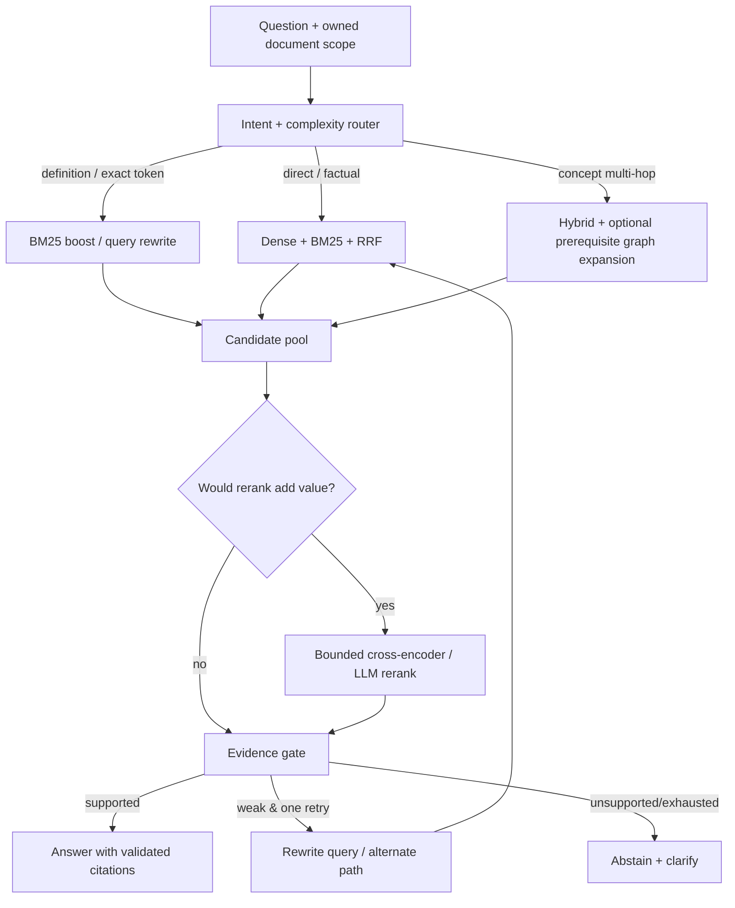

# Phase 4 — Adaptive RAG: Router, Hybrid, Graph and Evidence Grading

**Estimate:** 2–3 weeks · **Prerequisite:** baseline relevance labels and Tutor integration point.
**Objective:** improve *grounded answer quality* with measured cost and p95 latency; not maximize architectural complexity.

## 1. Existing system to preserve

`backend/src/study_supporter/infrastructure/retrieval/{bm25_adapter,hybrid_adapter,scoped_retriever}.py` and `ai/retrieval/rrf.py` implement a baseline hybrid Dense/BM25/RRF path. `application/contracts/retrieval.py` already defines `RetrievalQuery` and provenance-backed `Evidence`. Existing BGE-M3 model produces **1024-dimensional** embeddings, and current Chroma collection naming / persisted chunk IDs must not change without an explicit migration.

Do not replace existing retrieval in one PR; implement an `AdaptiveRetriever` behind the current `RetrieverPort` contract and feature flags. Document and user ownership are enforced *before retrieval, after retrieval, and before returning citations*.

## 2. Progressive retrieval architecture



**Router v1 rules first:** deterministic heuristics using question length, quoted/exact key terms, reference to concepts, explicit need for multi-hop, active topic and prior retrieval outcome. Evaluate an optional LLM classifier as a second experiment, not a prerequisite. A classifier must produce a typed label and confidence, with safe hybrid fallback on low confidence.

**Evidence grader:** evaluates whether retrieved snippets directly support the requested claims. Start with simple score/match/metadata checks; optional LLM grader can return `SUPPORTED | INSUFFICIENT | CONTRADICTORY` with cited chunk IDs and confidence. **It cannot invent evidence**; reject grading output with IDs absent from the original result set.

## 3. Detailed tasks and tests

### AR-01 — Baseline profiling and query taxonomy

- Record Recall@3/5/10, MRR@10, nDCG@10, citation precision, p50/p95, per-category breakdown (Vietnamese, table, multi-hop, no-evidence).
- Inspect score distribution and top-k truncation, BM25 Vietnamese tokenizer behavior, cross-document ordering, duplicate chunk IDs and exact source-page metadata.
- Determine smallest useful candidate pool (`dense_k`, `sparse_k`, fusion size) by ablation, not guessing.

### AR-02 — Query router

- Implement `QueryRoute = {simple, exact, multihop, unknown}` with reason code and confidence.
- Router input excludes any cross-user profile except an authorized, minimal active goal; no external system instructions from PDF text.
- Unit tests: whitespace/accents, acronym, exact quote, malicious “ignore previous rules”, mixed Vietnamese-English, missing topic, doc change.
- Route errors → baseline hybrid. Max one rewrite/alternative search by default.

### AR-03 — Candidate retrieval and reranking

- Existing dense/BM25/RRF is the A0 arm. Run A1 = query rewrite + hybrid, A2 = hybrid + rerank, A3 = router + selective rerank, A4 = graph expansion + hybrid.
- Reranker **pilot** uses a locally runnable multilingual model if latency/GPU budget allows; validate license/VRAM, cache separately, expose `RERANKER_ENABLED=false` default.
- Bound candidates (e.g. ≤30) and token budgets; do not rerank raw unrelated user documents.
- Preserve `(document_id, chunk_id, page, source)` on every transformed candidate. No duplicate citation IDs.

### AR-04 — Graph-informed retrieval

- Reuse concept graph stored from ingestion, but treat extracted prerequisite edges as noisy metadata, **not verified truth**. Check DAG/cycles via existing graph algorithms.
- First retrieve textual chunks, then expand by at most one or two graph hops to find related *source-backed* chunks. If graph lacks provenance or source links, **do not enable graph retrieval** yet: add concept-to-chunk mapping with additive storage and tests.
- Test missing graph, cycles, isolated node, graph matching no chunks, document change and contradictory evidence.

### AR-05 — Evidence grading and grounded answer

- Define `EvidenceDecision {grade, supporting_chunk_ids, reason_code, confidence, grader_version}` and `AnswerGrounding {claim_to_chunk_ids, unsupported_claim_count}`.
- LLM grader must not leak PDF content to unauthorized cloud provider: provider/data-policy review and config gating are required.
- Low confidence: one alternate retrieval **only if there is meaningful changed query/route**; otherwise abstain. Do not grow unbounded loops.
- Build deterministic claim-citation validator; reserve semantic attribution judgments for blind human/judge review.
- UI shows exact `page_start/page_end`, source and optional confidence phrased as “Nguồn kiểm chứng”, not unsupported certainty percentage.

### AR-06 — Adaptive quiz evidence

Replace “first five chunks” with topic-aware retrieval before quiz generation; require valid source chunks for every quiz. Distinguish retrieval failure from malformed model output and avoid presenting a guessed correct answer. Keep durable attempts and user ownership consistent with existing use cases.

## 4. Experiment grid (frozen dataset and provider)

| Variant | Router | Retriever | Rerank | Graph | Evidence grade |
|---|---|---|---|---|---|
| A0 baseline | no | current Dense+BM25+RRF | no | no | no |
| A1 | rules | same hybrid + rewrite | no | no | no |
| A2 | no | same hybrid | yes | no | no |
| A3 | rules | same hybrid | selective | no | yes |
| A4 | rules | same hybrid | selective | provenance-aware | yes |

Run paired comparisons, show absolute metrics, paired delta with CI, failure slices and compute/token/latency cost. **No cherry-picking best-performing questions or quietly changing the gold labels.** Select the simplest Pareto-optimal arm; complex A4 may be rejected if no real gain.

## 5. Proposed module changes

```text
backend/src/study_supporter/ai/retrieval/
  routing.py             # deterministic labeling, pure
  grading.py             # pure contract + validation
  provenance.py          # citation and chunk ID checks
backend/src/study_supporter/infrastructure/retrieval/
  adaptive_adapter.py    # current RetrieverPort implementation
  reranker_adapter.py    # lazy model / bounded work
  graph_adapter.py       # concept→chunk expansion
backend/src/study_supporter/application/contracts/retrieval.py
backend/tests/unit/test_adaptive_router.py
backend/tests/unit/test_evidence_grading.py
backend/tests/integration/test_adaptive_scope.py
```

Do not import LangChain/LangGraph into `ai/` pure algorithms; only orchestration and dedicated adapters call vendor SDKs. All cache keys include authorized document scope, index version, embedding version, query normalization and strategy version; prevent cross-tenant cache reuse.

## 6. Gates and rollback

**Minimum hard gates:** 0 unauthorized evidence, 0 fabricated source IDs, 0 silent quiz invalidity, bounded retries, clearly reported abstentions and unsupported documents. **Candidate quality gate:** Recall@5 +5pp or similar validated gain on held-out data, with citation precision not worse than baseline and p95 ≤1.5× baseline (or explicitly accepted trade-off). If uplift is not statistically credible, ship A0/A2 instead of A4.

Fallback: `RAG_STRATEGY=hybrid_legacy`; no reindex or destructive migration. Existing Chroma/SQL restore must still work. **Next:** [`04_MEMORY_PERSISTENCE.md`](04_MEMORY_PERSISTENCE.md).
