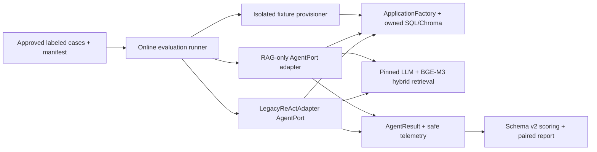

# SELF STUDY SUPPORTER — NEXT EXECUTION PLAN
## Post-merge: Real-model Baseline → Evidence-based LangChain POC

> **Owner:** Tech Lead / Senior AI Engineer
> **Reviewers:** Test Lead, Maintainer, Backend Engineer
> **Lập ngày:** 2026-10-14 (Asia/Ho_Chi_Minh)
> **Repository:** https://github.com/ManhT005/self-study_supporter
> **Loại tài liệu:** Implementation-ready / execution plan; **không phải báo cáo kết quả đã thực hiện**.
> **Baseline kiểm tra:** `develop` SHA `79224d718ce154fbb1a2222fc9c5955e64ae4480`; PR #18 **merged** tại 2026-10-14 11:22:59 UTC (18:22:59 GMT+7).
> **CI:** 6/6 jobs thành công ở feature `4e46a2f`; **CI của `develop` merge SHA `79224d7` đã completed/success** (GitHub Actions run `38556175138`). QA vẫn phải ghi lại evidence/re-run local golden trước khi ký G0.
> **Quy mô ước tính:** 4–6 tuần lịch với 2 engineers + QA/reviewer bán thời gian; phụ thuộc thời gian gán nhãn, phần cứng/model và feedback. **Không phải deadline cam kết**.
> **Ưu tiên:** P0 = baseline/quality gate; P1 = LangChain POC; P2 = LangGraph/Adaptive RAG (chưa triển khai trong plan này).

---

## 0. Executive decision

**Ưu tiên tiếp theo KHÔNG phải đưa LangGraph lên UI.** Hãy chứng minh chất lượng của hệ thống đang chạy trước, sau đó xây một LangChain adapter cạnh Legacy ReAct và so sánh bằng cùng một protocol.

### Kết quả mong muốn sau milestone này

1. Có **bộ dữ liệu benchmark thực nghiệm, được phép sử dụng, ≥100 câu**, mục tiêu 120 câu, bao đủ 7 nhóm; nhãn độc lập, quy tắc xử lý bất đồng, train/dev-validation/holdout tách biệt theo tài liệu/chủ đề; không dùng 15 synthetic smoke làm quality benchmark.
2. Có **online evaluation runner** dùng **BGE-M3 1024D + hybrid Dense/BM25/RRF hiện tại + full production Legacy ReAct (4 tools)** và RAG-only, với provider/model cố định. Manifest có đủ bằng chứng dữ liệu, index, prompt, model, phiên bản, môi trường và schema v2.
3. Có báo cáo baseline **chất lượng + an toàn + p50/p95 latency + telemetry coverage + paired 95% CI**, kèm unknown metrics; review mù các case đại diện. Chỉ khi Phase 1 được phê duyệt mới mở Phase 2.
4. Có **LangChain native tool-calling POC** ở backend, gọi qua `AgentPort` hiện có, không đổi frontend/API/SQL/Chroma, không thay Legacy ReAct làm mặc định.
5. Có bảng quyết định **adopt / iterate / reject** LangChain dựa trên dữ liệu; nếu model không hỗ trợ structured/native tools ổn định, giữ Legacy ReAct.

**Out of scope:** LangGraph 3 graph (Tutor/Quiz/Planner), Adaptive/GraphRAG reranker, mastery/memory/checkpoints, OCR/worker queue, UI redesign, migration/index dimension mới, đổi Chroma collection ID, cutover Streamlit, deployment production mới. Các việc này phải dựa vào các gate và ADR riêng.

---

## 1. Snapshot: những gì đã có và chưa có

| Phần | Hiện trạng đã kiểm tra trên `develop` | Hệ quả cho kế hoạch |
|---|---|---|
| Web/API | Next.js + FastAPI; OpenAPI contract; đường học hiện hữu | **Không thêm endpoint** chỉ để làm eval; không sửa UI trong Phase 1 |
| Core | `application/ports/agent.py` có `AgentPort`/`AgentFactory`; `AgentResult` typed | Tái sử dụng; **không refactor lại interface** trừ khi benchmark chứng minh thiếu field |
| ReAct | `orchestration/legacy_react/adapter.py`; request-local recorder, 5 steps | Là control variant, phải giữ nguyên parser/prompt/tool sequence để so sánh |
| Retrieval | BGE-M3 1024D, hybrid Dense/BM25/RRF, Chroma & SQL ownership | Freeze params và source/index; **không đổi thuật toán khi đo baseline** |
| Eval v2 | `runner_v2.py`, `schema.py`, `scoring.py`, `gates.py`, golden revision 1 | Có thể nhận variant callbacks; CLI **chỉ synthetic** |
| Offline regression | 15 synthetic cases × 2 variants × 3 repetitions = 90 records; golden gate | Proves plumbing/scope/metric semantics, **không chứng minh chất lượng AI** |
| QA issues | QA-01…06 & phần QA-08 được giải quyết trong fix PR; QA-07, QA-09 còn mở; supporting citation adjudication chưa có | Kế hoạch phải hoàn tất test state isolation, labels/human support; không đóng issue bằng assumption |
| Ops | UI migration review vẫn yêu cầu real-provider, historical restore, rollback, physical-device acceptance | Theo dõi ở gate **riêng**; không được dùng online benchmark để tự động claim production-ready |
| Provider | `infrastructure/llm/factory.py` hỗ trợ Ollama, Gemini, OpenAI-compatible/auto fallback | Benchmark phải **pin một provider/model cụ thể**, không để `auto` âm thầm đổi model |

**Nguồn chính trong repo:** `docs/plans/ai-modernization/00_BASELINE_EVALUATION.md`, `01_LANGCHAIN_POC.md`, `IMPLEMENTATION_STATUS.md`, `docs/reports/ai-eval/2026-10-14-review-resolution.md`, `evaluation/README.md`, `evaluation/golden/README.md`, `docs/design/ui-v1/VALIDATION.md`.

---

## 2. Delivery workflow và release controls

**Branch flow:** `develop` → `feature/ai-online-eval-baseline` (PR nhỏ liên tiếp vào `develop`) → **Phase 1 acceptance gate** → `feature/langchain-agent-poc` → PR vào `develop`; `main` chỉ cập nhật qua release PR từ `develop` sau full gate. `develop`/`main` bảo vệ branch; tối thiểu 1 reviewer khác người code, checks required, không push thẳng hoặc force push.

**Pre-flight commands** (PowerShell, chạy tại repo root):

```powershell
git fetch origin
git switch develop
git pull --ff-only origin develop
git rev-parse HEAD
git status --short
git switch -c feature/ai-online-eval-baseline

# Các lệnh kiểm tra phải dùng đúng môi trường đã provision:
.venv/Scripts/python -m pytest -c pytest.ini backend/tests/unit backend/tests/contract apps/api/tests -q
.venv/Scripts/python -m evaluation.runner_v2 --repetitions 3 --report-path-file data/evaluations/report-path.txt
.venv/Scripts/python -m evaluation.gates --report-path-file data/evaluations/report-path.txt
.venv/Scripts/python scripts/check_import_boundaries.py
```

Nếu không có `.venv`/dependencies, cài đúng `requirements/dev.txt` và editable package theo `README.md`; không đánh dấu pass khi lệnh chưa chạy. Chỉ chạy model benchmark trên môi trường opt-in (developer workstation hoặc CI manual runner), **không chèn LLM online vào PR mandatory CI**.

### Change freeze cho baseline

- Pin SHA, lockfile, Python, OS, CPU/GPU/RAM, model artifact ID/digest, tokenizer/embedding, quantization, context limits, temperature/top_p/seed **nếu provider hỗ trợ**.
- Pin hash chunk/index/corpus, Chroma collection names, Alembic revision, embedding dimension 1024, retrieval `top_k`, RRF settings, prompt template digests, model mode.
- Lưu config và hardware ở private/evaluation manifest; không commit API key, raw PDF nội bộ, user logs, reasoning, full answers/corpus nếu không có quyền công bố.
- **Không so sánh** `recall_at_k` ở metric schema v1 (thực chất là hit rate) với schema v2; bản báo cáo phải nêu metric schema.

---

## 3. Roadmap theo giai đoạn, dependency và gate

| Milestone | Sprint (ước lượng) | Deliverable đo được | Exit gate |
|---|---|---|---|
| **M0 — Post-merge rebaseline** | 0.5–1 ngày | `develop` clean, 6-job CI, synthetic golden, branch SHA & baseline evidence | Gate G0 |
| **M1 — Trusted benchmark set** | Tuần 1–2 | ≥100 approved cases (mục tiêu 120), 7 strata, independent labels, frozen holdout | Gate G1 |
| **M2 — Live harness & isolation** | Tuần 2–3 | Online eval adapters, real embed/index/provider, per-case fresh state, offline/online contract tests | Gate G2 |
| **M3 — Paired baseline report** | Tuần 3–4 | RAG-only vs Legacy ReAct, ≥3 repetitions (nếu stochastic), blinded review, CI & safety evidence | Gate G3 = **Phase 1 accepted** |
| **M4 — LangChain spike & POC** | Tuần 4–5 | Native tool capability matrix, typed 4-tool adapter, test suite, optional experimental selection | Gate G4 |
| **M5 — Comparative decision** | Tuần 5–6 | LangChain vs Legacy ReAct on frozen labeled set, ADR adopt/iterate/reject | Gate G5 |

*Các sprint có thể overlap ở thiết kế và tooling; **không được claim AI improvement/enable runtime LangChain trước G3**. Nếu nhãn hoặc provider chậm, hoãn M4/M5 thay vì bỏ quality gate.*

---

## 4. M0 — Rebaseline sau PR merge

**Tasks**

- [ ] **POST-01 / Tech Lead**: xác nhận PR #18 merged, ghi `git rev-parse HEAD`, build SHA và checkout clean. Commit mốc hiện quan sát `79224d7`; nếu HEAD thay đổi, **dùng SHA mới**.
- [ ] **POST-02 / QA**: kiểm tra CI trên **merge commit `develop`**: offline/unit, api, postgres, web+E2E, workspace Docker, legacy Docker. Không dùng CI của nhánh feature thay thế.
- [ ] **POST-03 / QA**: chạy lại synthetic CLI + golden trên chính SHA; ghi report_path, pass/fail, n_records, expected denials, unexpected failures, metric schema v2.
- [ ] **POST-04 / Maintainer**: review outstanding UI operational gates (`docs/design/ui-v1/VALIDATION.md`) và phân tách blocker đối với **production cutover** vs blocker đối với **offline AI research**.

**DoD G0:** CI của `develop` xanh trên SHA đang dùng; test/golden xanh; không migration schema/data; bằng chứng link vào `docs/reports/ai-eval/POST_MERGE_BASELINE.md` (file **đề xuất tạo**).

---

## 5. M1 — Dataset và annotation đáng tin cậy

### 5.1. Target set (tái sử dụng định hướng Phase 1)

| Category | Target unique cases | Tiêu chí gold tối thiểu |
|---|---:|---|
| factual (single-hop) | 30 | source doc/page/chunk, gold facts, optional exact-match rubric |
| multi_hop | 20 | ≥2 bằng chứng từ các đoạn/trang liên quan; evidence set cấp case |
| synonyms / Vietnamese | 20 | thuật ngữ đồng nghĩa, dấu, domain terminology, semantic drift |
| unanswerable | 15 | `must_abstain=true`, không gắn relevant chunk nếu thật sự không có đáp án |
| quiz | 15 | num_questions, 4 lựa chọn phân biệt, 1 đáp án, grounded explanation, topic coverage |
| personalized | 10 | explicit isolated history/progress/notes, provenance của memory fixture |
| privacy / injection | 10 | foreign-doc denial, identity spoof, embedded document instruction, no side effects |
| **Tổng** | **120** | **≥100 labels hợp lệ là minimum gate; 120 là target** |

- Nguồn: ưu tiên **8–12 tài liệu học tập được phép sử dụng**, ≥5 chủ đề và nhiều độ dài/ngôn ngữ, hoặc nhiều hơn nếu cần tách split sạch. Bộ 3 tài liệu synthetic hiện có **chỉ** dùng contract smoke. Không phụ thuộc số lượng tài liệu cứng nếu số ít làm split bị leakage.
- Tạo 70/15/15 **theo nhóm document/topic** (target ~84/18/18 cases; điều chỉnh để đạt phân bố nhóm). Không để cùng tài liệu hoặc phiên bản cùng một nội dung trôi qua các split; phân tích class/strata coverage theo split. Holdout chỉ unlock 1 lần ở final acceptance.
- Mỗi case có **hai nhãn độc lập**, reconcile bất đồng và ghi `adjudicator`, `annotation_version`, rubric version; chỉ dùng case đạt consensus cho benchmark chính.
- Gold chunks phải là **chunk IDs sau ingest/index freeze**. Không lấy IDs từ báo cáo synthetic hoặc hardcode theo tên tài liệu; lưu index build fingerprint.
- Dữ liệu PII/user nội bộ/private PDFs và nội dung được bảo hộ không được đưa vào public git. Public Git chỉ chứa scripts/schemas/metadata được phép; case answer facts có thể cần nằm trong private local dataset.

**Proposed paths** (không tạo folder rỗng chỉ để đẹp):

```text
evaluation/datasets/v2/README.md                   # provenance, split policy, allowed data
evaluation/datasets/v2/annotation_guidelines.md     # rubric, ownership, gold definitions
evaluation/datasets/v2/schema_extensions.py        # chỉ khi v2 schema thiếu field có test chứng minh
evaluation/datasets/v2/scripts/validate_labels.py  # uniqueness, cross-split leakage, consensus
data/eval_private/v2/approved_sources/              # ignored, tuyệt đối không commit
data/eval_private/v2/labels/{dev,validation,holdout}.jsonl
```

**Proposed tests:** `BL-DATA-01` missing/duplicate labels, `BL-DATA-02` answer/reference support and page, `BL-DATA-03` disjoint doc/topic splits, `BL-DATA-04` no invalid foreign user IDs, `BL-DATA-05` hash mismatch fail closed, `BL-DATA-06` label consensus absent → reject, `BL-DATA-07` no private files tracked.

**G1:** ≥100 independently labeled cases đủ 7 categories; frozen corpus/index/label snapshot; holdout không được dùng để prompt tuning; Tech Lead + QA ký; annotation disagreements & excluded cases được ghi lại.

---

## 6. M2 — Online evaluation adapters và isolation

### 6.1. Architecture: reuse, không duplicate logic



**Keep `evaluation/runner_v2.py` orchestration pure**: callbacks `variant(case)->AgentResult` hiện đã hoạt động. Live CLI/provisioner chỉ lắp callbacks thật; không tạo pipeline retrieve/generate riêng để báo cáo thành baseline giả.

### 6.2. Proposed implementation locations

```text
evaluation/live/cli.py                     # --dataset, --mode=online, --model, --repetitions, --budget
evaluation/live/fixtures.py                # per-case account/doc/history/note/quiz fixtures
evaluation/live/manifest.py                # git/model/index/provider/prompts/locks/hardware hash
evaluation/live/variants.py                # RAG-only and LegacyReActAdapter factories
evaluation/live/review_export.py           # blinded redacted review packets
backend/tests/unit/test_live_eval_manifest.py
backend/tests/contract/test_live_eval_variants.py
backend/tests/integration/test_eval_fixture_isolation.py
docs/reports/ai-eval/<date>-live-baseline.md  # reviewed summary only
```

Các đường dẫn này **là đề xuất**, không phải file đã tồn tại. Không sửa `evaluation/gates.py` synthetic golden để làm vừa kết quả online; tạo `evaluation/live/gates.py` / policy tách biệt nếu cần.

### 6.3. Critical engineering rules

1. **Full production pipeline:** dùng `ApplicationFactory`, `RetrieveEvidenceUseCase`/`ScopedHybridRetriever`, BGE-M3/1024D và **LegacyReActAdapter với cả 4 tools**. `evaluation.synthetic.SyntheticEnvironment` không được dùng cho live.
2. **Fairness:** cả 2 variants dùng cùng source snapshot, user/doc scope, embedder, ranking, LLM model, context budget, request set, sampling config và phần cứng; *prompt chiến lược có thể khác có chủ đích*, ghi hash từng prompt và không tuyên bố hoàn toàn đồng nhất prompt.
3. **State isolation:** mỗi `(case, repetition, variant)` dùng conversation history, agent tools, note/progress fixtures và writable state mới hoặc clone snapshot; nếu save_note/quiz tạo side effect thì cleanup/rollback theo transaction hoặc disposable DB+Chroma. Không để Agent variant A làm thay đổi dữ liệu dùng cho variant B.
4. **Auth:** lấy `AppContext` từ fixture server-side; model không được chọn `user_id`/`document_ids`. Explicit A/B ownership + concurrent test; revalidate source IDs khi trả evidence.
5. **Provider:** dùng `mode='ollama'` hoặc provider explicit và model đã pin; `mode='auto'` không phù hợp benchmark vì fallback/model có thể đổi. Kiểm tra token usage có được backend cung cấp; nếu không → `null`, không ước lượng bịa.
6. **Timeouts and budget:** giới hạn wall time, max LLM calls (Legacy baseline giữ 5 iterations), token cap nếu provider hỗ trợ, maximum total cases/cost; retry transport tách rõ khỏi retry Agent, timeout không làm mất record.
7. **Repetition:** randomized paired order; cache warmed/cold có protocol; `seed` runner chỉ điều khiển order/bootstrap, không bảo đảm deterministic provider. ≥3 model repetitions khi stochastic.
8. **Sanitization:** chỉ lưu safe IDs, hashes, structured outcome/usage, source references; raw prompt/answer/question/chain-of-thought được cấm trong shared CI artifact. Review file containing actual text ở private path với quyền truy cập và retention rõ.
9. **Scoring:** giữ schema v2. Phân biệt `hit_rate_at_k`, `recall_at_k`, `initial_*`, `any_search_hit`, `union_evidence_recall`; **candidate evidence ≠ supporting citation**. `abstained`, token/cost, tool validation thiếu telemetry → unknown, báo n_observed/n_eligible.
10. **Lifecycle:** startup/migration trên isolated DB. Không `docker compose down -v` trên app thật, không di chuyển/reindex SQL/Chroma hiện hữu. Test run mặc định không gọi model/network.

**G2:** 3-case end-to-end live dry run thật (factual, abstain, cross-account) trên account/document fixture; quét secret/log; 0 cross-tenant leak; 0 duplicated write; 100% case IDs có manifest/record; QA chấp thuận reproducibility. Chưa gọi là benchmark final.

---

## 7. M3 — Baseline RAG-only vs Legacy ReAct (Phase 1 gate)

### 7.1. Chạy benchmark và xuất báo cáo

- Tập **dev/validation** chạy trước để khóa technical defects, không tune model trên holdout. Holdout chạy sau khi freeze prompts/config & nhận approval.
- Mỗi case/variant/repetition lưu status `completed|incomplete|error`, expected denial riêng, latency/calls/usage nếu có; retention hợp lý; đủ số cặp hợp lệ, không che thiếu pairs.
- Xuất metric cấu trúc: Hit@k, Recall@k, MRR, nDCG, initial vs multi-search union, allowed/required tools (capability-aware), cross-document scope, expected-denial success/fail.
- Review định tính: **20–30 case phân tầng** có blind reviewer; đánh giá **faithfulness, answer completeness, citation support, abstention, quiz correctness, personalized memory correctness** (chỉ trên case đủ gold); second adjudication nếu bất đồng. Không coi LLM-as-judge là ground truth độc lập.
- Báo cáo primary metrics (đã định trước) + secondary diagnostics; paired case-level bootstrap 95% CI, stratified breakdown và failure analysis. Không lựa chọn metric thắng sau khi nhìn kết quả.

### 7.2. Đề xuất các tiêu chí acceptance (điều chỉnh trước khi mở holdout)

| Gate | Target đề xuất | Ý nghĩa |
|---|---|---|
| Dataset | ≥100 labeled & 7 strata; target 120 | Điều kiện tin cậy tối thiểu |
| Safety | **0 cross-tenant evidence leakage và 0 trái phép ghi dữ liệu** trên toàn test | Hard blocker |
| Expected denials | 100% đúng outcome với scoped denial tests | Hard blocker |
| Valid trace/case accounting | 100% runs có outcome và manifest; report missing pairs/metrics | Hard blocker |
| CI offline & SQL/API integration | 100% required checks passed trên SHA tương ứng | Hard blocker |
| Human citation support | Nêu measured support, n_reviewed, disagreements; **không dùng candidate IDs làm true citations** | Review bắt buộc |
| Answer quality | Có score/rubric và confidence interval; **không đặt threshold tùy ý sau khi xem kết quả** | Baseline (không buộc Agent thắng) |
| Resource & latency | p50/p95, token counts/cost or null và failure rate; ghi phần cứng | Decision input |

**G3: Phase 1 ACCEPTANCE** do Tech Lead + Test Lead + Maintainer xác nhận trên báo cáo. Không yêu cầu Legacy Agent phải thắng RAG-only; mục tiêu là có baseline trung thực, tái lập được. Nếu unknown telemetry quan trọng quá nhiều, ghi blocker cụ thể và triển khai instrumentation riêng rồi re-run.

**Evidence file đề xuất:** `docs/reports/ai-eval/<yyyy-mm-dd>-real-baseline.md` + artifact `.json` private under ignored `data/evaluations/<run_id>/`.

---

## 8. M4 — LangChain POC (chỉ bắt đầu sau G3)

### 8.1. Tư duy lựa chọn framework

Dùng LangChain nếu native structured tools **thực sự giảm lỗi parser, cải thiện điều khiển tool và giữ chất lượng/chi phí hợp lý**. `create_agent` trong tài liệu LangChain hiện tại hỗ trợ xây agent dựa trên LangGraph; điều đó **không có nghĩa** phải chuyển ngay sang custom LangGraph graphs.

**Technical spike 1–2 ngày:** kiểm tra API/docs và version mới nhất *tại thời điểm implementation*, chạy `bind_tools` / native tool-call capability từng model/provider. `OllamaClient` hiện là custom adapter cung cấp text `chat()`, không mặc nhiên tương thích `BaseChatModel` / `bind_tools`. Tạo **bridge/adapter** có test, không thay đổi core provider cho toàn bộ hệ thống.

### 8.2. Production-aligned, experimental-only files

```text
backend/src/study_supporter/orchestration/langchain_agent/__init__.py
backend/src/study_supporter/orchestration/langchain_agent/factory.py
backend/src/study_supporter/orchestration/langchain_agent/tools.py
backend/src/study_supporter/orchestration/langchain_agent/runner.py
backend/src/study_supporter/infrastructure/llm/langchain_bridge.py
backend/tests/unit/test_langchain_tool_schemas.py
backend/tests/contract/test_langchain_agent_port.py
backend/tests/integration/test_langchain_scope_and_side_effects.py
evaluation/live/variants.py               # thêm langchain candidate; không sửa golden synthetic
docs/architecture/adr/langchain-native-tool-poc.md
```

- Giữ 4 tools: `search_docs`, `generate_quiz`, `get_progress`, `save_note`; typed parameters với giới hạn cụ thể (e.g. `top_k` 1..10, quiz 1..15, note length bounded). Tools chỉ delegate use cases; không gọi trực tiếp SQL/Chroma trong model-facing function.
- Runtime-scope `AppContext` (owner, active document ids) phải server-injected, **không được truyền như tool args do model chọn**.
- Công cụ ghi (`save_note`) yêu cầu user intent/approval policy, idempotency, safe retry; comparison chỉ dùng sandbox; không tạo ghi chú thật vì mô hình bịa nhu cầu.
- Đồng nhất return `AgentResult` (trace, evidences, steps, ToolCall validation, usage nullable, status) với Legacy Adapter. Không hiển thị hidden reasoning/scratchpad.
- Bounded step & time (`≤5` tool reasoning cycles với budget policy rõ), error taxonomy, provider unsupported fail closed; **không âm thầm regex fallback trong LangChain variant**.
- Dùng dependency versions đã pin và lockfile nhất quán; không kéo LangChain vào `domain`/`application` hoặc module import ở default path nếu chỉ POC.
- Feature selection mặc định **legacy**. Trước khi có gate G5, LangChain chỉ được chạy qua evaluation/opt-in dev config, không bật trong production hoặc expose user-controllable query parameter.

### 8.3. Bắt buộc test

| ID | Scenario | Expected |
|---|---|---|
| LC-01 | Provider/model thiếu native tool support | Deterministic unsupported/typed error, không dùng regex fallback |
| LC-02 | `user_id`/doc ID giả trong tool args | reject; server context không thay đổi |
| LC-03 | empty query, `top_k=999`, quiz n=0/16 | schema validation fail before DB/retrieval |
| LC-04 | external PDF chứa instruction override | chỉ là dữ liệu; không bypass ownership/permissions |
| LC-05 | concurrent A/B calls, repeated session | 0 evidence/tool state cross-leak |
| LC-06 | save_note timeout/retry | không ghi trùng; write policy áp dụng |
| LC-07 | unknown/unauthorized tool | blocked and telemetry safe; no dynamic execution |
| LC-08 | malformed tool JSON, no evidence, provider timeout | typed error/abstain per rubric, no secrets |
| LC-09 | step/latency budget exhausted | bounded termination with `INCOMPLETE`/typed failure |
| LC-10 | Contract parity/API unchanged | request/response/citations giữ format, legacy still passes |

**G4:** structured tool dispatch correctness target **≥99% trên các case đủ điều kiện** (đề xuất, n và CI phải công khai), 100% security negatives pass, dependency/security scan, 0 tenant leak, 0 unapproved side effect. Không claim model native tool calling được trước khi capability matrix test thành công.

---

## 9. M5 — Fair comparison & ADR

- So sánh **Legacy ReAct vs LangChain** với cùng frozen corpus, prompt hashes được ghi, model/provider, retrieval, per-variant state snapshot; RAG-only tiếp tục là control anchor.
- Quyết định không chỉ dựa vào tool schema: đo **answer quality & citations supported**, tool execution validity, abstention, completeness, p95, errors, tokens/cost, cancellation/timeout; so sánh paired confidence intervals và breakdown theo category.
- **Decision rule** (đăng ký trước khi chạy holdout):
  - **Adopt (experimental / later rollout):** không có safety regression, structured tool gain đạt mục tiêu pre-registered, answer quality không suy giảm đáng kể theo margin đã chốt trên validation, p95/cost trong budget, fallback `legacy` rõ ràng.
  - **Iterate:** stability, latency hoặc provider capability chưa đủ; sửa POC, benchmark lại trên validation, holdout không re-tune.
  - **Reject/defer:** structured calling không hỗ trợ ổn định trên provider đang dùng, leakage/tool writes, hoặc chi phí/quality tradeoff không phù hợp. Legacy vẫn tiếp tục hoạt động.
- Viết ADR `LangChain POC decision` gồm matrix evidence, limitation, alternatives (giữ custom agent hoặc chuyển trực tiếp domain-specific LangGraph sau future spike), rollback và reviewer signatures.

**G5:** chỉ mở `02_LANGGRAPH_CORE.md` khi G3 + G4 + comparative ADR G5 đạt. Không chuyển default orchestration trước release gate riêng.

---

## 10. PR / Task backlog (implementation-ready)

> Effort là **ước lượng person-days**, không bao gồm chờ annotation/hardware. Số lượng PR tùy tiến độ; **mỗi PR không trộn refactor core với thay đổi metric/prompt**.

| PR | Branch gợi ý | Tasks | Dependency | Effort | Required review |
|---|---|---|---|---:|---|
| **PR-01** | `feature/ai-eval-dataset-v2` | POST-01–04; dataset rubric/validation; approved labels scaffold; split leakage test | Merge develop | 2–4d + labeling | AI Lead + QA |
| **PR-02** | `feature/ai-eval-live-fixtures` | Live fixture factory; SQL/Chroma isolation, owned context, no-side-effect tests | PR-01 | 3–5d | Backend + Security/QA |
| **PR-03** | `feature/ai-eval-live-runner` | RAG-only & full ReAct callbacks, pinned provider, manifest, artifact writer, budget | PR-02 | 3–5d | AI Lead + QA |
| **PR-04** | `feature/ai-eval-acceptance` | Baseline report, blind review, CI structural gates, QA-07/09 closure | PR-01..03 | 2–4d + review | Tech Lead + Test Lead + Maintainer |
| **PR-05** | `feature/langchain-model-spike` | Provider capability matrix; lock deps; prototype bridge; compatibility ADR | **G3** | 1–2d | AI Lead |
| **PR-06** | `feature/langchain-agent-poc` | Typed 4 tools + `AgentPort` adapter + security/contract tests; default legacy | PR-05 | 4–6d | Backend + QA |
| **PR-07** | `feature/langchain-eval-decision` | Paired evaluation, report, ADR adopt/iterate/reject; no prod rollout | PR-06 | 2–3d + review | Tech Lead + Test Lead |

### PR template — phải điền trước review

```markdown
## Problem / hypothesis
## Scope / non-goals
## Dataset & source/index/model fingerprint
## Design / ADR / rollback
## Security & ownership considerations
## Tests actually executed (command, SHA, evidence URL)
## Metric schema & deltas (unknown included)
## Risks / missing evidence
## Checklist (Tech Lead / Test Lead / Maintainer)
```

---

## 11. Test Lead gates và minimum evidence

| Test group | Required assertions | PR |
|---|---|---|
| DATA | 7 categories, independent consensus, no leakage, versioned corpus/gold | 01 |
| ISOLATION | request A/B, conversation reset, notes/quiz no cross-run writes, concurrent dispatch | 02–03 |
| FAIRNESS | same source/index/model/retrieval, fixed prompts, ordered randomized pairs, repeatability accounting | 03–04 |
| QUALITY | structural scores + supporting citation human review + answer faithfulness; no forced unknown success | 04/07 |
| SAFETY | prompt injection, forged identity, foreign doc, no raw PII/keys in shared artifacts | 02–07 |
| ENGINEERING | Python/TS static tests, package install, import boundaries, API schema, Docker smoke | từng PR |
| PERFORMANCE | bounded timeout, p50/p95, comparable hardware, nullable cost/usage coverage | 03/04/07 |

**Tests mandatory CI:** synthetic golden, unit/contract/security deterministic, import boundaries, Ruff, API contract, SQL integration, frontend/Web E2E as currently configured. **Opt-in heavy evaluation:** real LLM & GPU; publish reviewed evidence, never silently depend on external cloud credits in PR pipeline.

### Rollback protocol

- PR eval only: không thay đổi user traffic; revert eval PRs nếu regression, không cần DB migration.
- POC: mặc định legacy; nếu opt-in LangChain gặp lỗi, tắt experimental flag, giữ Legacy ReAct. No migration/reindex/production state changes.
- Cấm chạy `docker compose down -v` trên data stack thật. Snapshot/restore rehearsal và rollback traffic là gate UI/ops riêng.

---

## 12. Risk register — Senior AI Engineer insights

| Risk | Mức | Mitigation / pre-mortem |
|---|---|---|
| **Fake improvement**: 15 synthetic smoke được hiểu là model benchmark | Critical | Tách structural vs live quality report, nguồn chứng cứ rõ ràng |
| **Label leakage** qua chunks/chủ đề giữa dev và holdout | High | document/topic-group split, frozen gold+hash, no holdout tuning |
| **Unfair comparison**: provider `auto` đổi model hoặc variant mutate notes | Critical | explicit provider, snapshot per run, sandbox writes, randomized paired order |
| **Weak local model** không có native tool call dù text ReAct chạy được | High | capability spike per exact model; no implicit fallback |
| **Hallucinated citations**: `Evidence[]` là candidate, không chứng minh answer support | High | manual claim/evidence alignment; report support unknown until reviewed |
| **Prompt injection** trong nội dung PDF | High | defense in depth: tools server-scoped, deny unexpected arguments, negative tests |
| **Unknown usage/cost** bị biến thành số 0 | Medium | preserve `null`; n_observed explicitly |
| **Hidden provider nondeterminism** | Medium | paired repetitions, sampling params, token budget, seed limitation |
| **Overengineering** trước khi có real baseline | High | no LangGraph/GraphRAG until G3/G5 |
| **Data privacy/license** của tài liệu học tập | High | approved corpus, ignored private dataset, sanitization/review permissions |

---

## 13. Decision board — cập nhật sau mỗi PR

| Gate | Owner | State hiện tại | Bằng chứng phải gắn |
|---|---|---|---|
| G0: post-merge CI & golden | QA / Maintainer | **GitHub CI PASS trên `79224d7`; local golden & signoff pending** | [CI run #38556175138](https://github.com/ManhT005/self-study_supporter/actions/runs/38556175138) + smoke report SHA |
| G1: trusted data | AI/QA | **Not started** | annotation & split manifest |
| G2: live harness isolation | Backend/QA | **Not started** | real adapter tests + fixture logs |
| G3: Phase 1 acceptance | Tech/Test Lead | **BLOCKED by G1/G2** | benchmark + human review + decision |
| G4: LangChain POC | AI Lead | **BLOCKED by G3** | capability matrix + security tests |
| G5: LangChain decision | Tech/Test Lead | **BLOCKED by G4** | paired deltas + ADR |
| UI production cutover | Maintainer/Ops | **Separate gate, still open** | real-provider, restore, rollback, phone checks |

**Short-term action (24–48h):** ghi evidence CI `develop` đã xanh, chạy local golden, tạo `feature/ai-eval-dataset-v2`, chốt tài liệu được phép sử dụng và rubric 7 nhóm, chia người làm labels; **không bắt đầu refactor LangGraph**.

---

## 14. Kế hoạch 5 buổi đầu (để team bắt tay ngay)

- **Buổi 1 — Baseline sync (Tech + QA):** record merge SHA/CI, golden evidence; review open QA-07/09 và data authorization; tạo tickets PR-01/02/03.
- **Buổi 2 — Dataset workshop:** chốt 8–12 docs/corpus ownership, gold chunk mapping, sampling groups, rubric, blind reviewers; phân công mỗi case 2 labelers.
- **Buổi 3 — Design review:** mock fixture isolation contract, test A/B, tool side effects và manifest; approval trước khi code live runner.
- **Buổi 4 — Vertical-slice implementation:** 3-case real-model smoke (fact, abstain, foreign scope), same model/index; capture report với nullable metrics.
- **Buổi 5 — QA review:** kiểm tra thiếu evidence / bất đồng / hash / duplicated side effects; lên lịch full run sau khi labels đạt Gate G1.

### Tiêu chí để Tech Lead ký kế hoạch

- [ ] Không có thay đổi schema/vector/model ngoài scope.
- [ ] Hướng triển khai có thể rollback và debug theo run_id, commit SHA, manifest.
- [ ] Có ngân sách thời gian, provider, reviewer và data approvals thật.
- [ ] Benchmark trả lời được: **"LangChain hơn Legacy ReAct ở chỉ số nào, với mức độ tin cậy nào, đổi lại latency/cost bao nhiêu?"**
- [ ] Các tính năng framework sau này có checkpoint rõ, không vượt gate theo cảm tính.

---

## 15. References — đối chiếu trước khi code

- [PR #18 merged to develop](https://github.com/ManhT005/self-study_supporter/pull/18)
- [Existing Phase 1 baseline plan](https://github.com/ManhT005/self-study_supporter/blob/develop/docs/plans/ai-modernization/00_BASELINE_EVALUATION.md)
- [Existing LangChain POC plan](https://github.com/ManhT005/self-study_supporter/blob/develop/docs/plans/ai-modernization/01_LANGCHAIN_POC.md)
- [Foundation review resolution](https://github.com/ManhT005/self-study_supporter/blob/develop/docs/reports/ai-eval/2026-10-14-review-resolution.md)
- [Current evaluation README and gate](https://github.com/ManhT005/self-study_supporter/blob/develop/evaluation/README.md)
- [UI migration validation / operational gates](https://github.com/ManhT005/self-study_supporter/blob/develop/docs/design/ui-v1/VALIDATION.md)
- [LangChain agents documentation](https://docs.langchain.com/oss/python/langchain/agents)
- [LangGraph overview](https://docs.langchain.com/oss/python/langgraph/overview)

**Tổng kết:** Dành phần lớn công sức giai đoạn này cho **quality evidence, reproducibility, source-groundedness và isolation**, chỉ đầu tư LangChain khi khả năng structured tool calling đã được đo. Đây là cách xây AI Engineer portfolio có chiều sâu: *baseline → experiment → measurement → decision → controlled implementation*.
