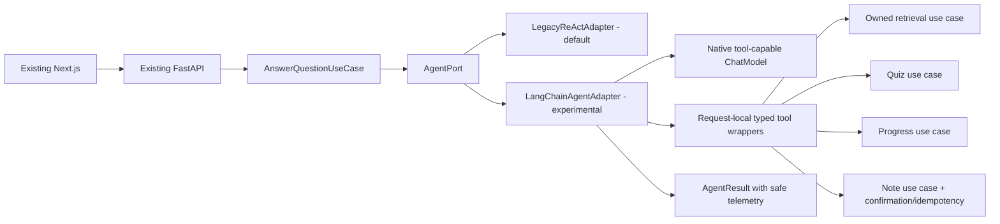

# Self Study Supporter — LangChain POC: Implementation-Ready Plan

> Implementation tracking (2026-10-15): this is the original planning snapshot.
> Engineering slices LC-PR01..04 are implemented for review on
> `feature/langchain-agent-poc`; see the [test report](../../reports/ai-eval/2026-10-15-langchain-poc.md).
> Live provider validation, independent approvals, LC-PR05 and release gates remain open.

**Date:** 2026-10-14
**Owner:** Senior AI Engineer / Tech Lead
**Reviewers:** Backend Engineer, Test Lead, Maintainer
**Target branch:** `feature/langchain-agent-poc` from updated `develop` **after PR #19 is merged** (do not branch from an unmerged PR). If work must start earlier, use a separate `spike/langchain-native-tools` branch from current `develop` and keep it independent of PR #19.
**Status:** PROPOSED — not implemented; no runtime/feature flag enabled.
**Existing docs:** `docs/plans/ai-modernization/01_LANGCHAIN_POC.md` and `09_POST_MERGE_AI_EXECUTION_PLAN.md` (currently in PR #19).

## 1. Decision: do not block writing the POC on completing the whole online benchmark

The prior execution plan makes G3 (full Phase 1 benchmark acceptance) a prerequisite for M4. **Revise this dependency**:

- **Allowed now (parallel track):** architecture decisions, package compatibility spike, native tool-calling capability probe with a strict request budget, request-local typed tool wrappers, LangChain `AgentPort` adapter, deterministic contract/security tests, opt-in smoke through isolated fixtures.
- **Not allowed until G3 & Test Lead signoff:** replacing Legacy ReAct as production default; claiming LangChain is better; customer-facing rollout, traffic experiments using real user data, altering historical embeddings/SQL/Chroma, or passing a quality release gate based on the synthetic fixture.
- **Avoid more evaluation infrastructure work** unless a POC needs one specific missing field/test. PR #19 owns baseline and label work. Share the same `AgentResult` and runner rather than duplicating them.

**Business outcome:** an experiment-only LangChain agent capable of querying authorized documents, reading current progress, generating a schema-validated quiz and saving an explicitly approved note without changing HTTP response fields.

## 2. Current code facts and non-goals

| Existing capability | Verified location / consequence |
| --- | --- |
| Framework-neutral `AgentPort.execute(AnswerRequest)->AgentResult` | `backend/src/study_supporter/application/ports/agent.py` — **reuse** |
| `AgentResult`, `AgentStatus`, `AgentUsage`, `ToolCall`, `RetrievalCall` | `backend/src/study_supporter/application/contracts/agent.py` — **reuse; extend only when a failing test proves need** |
| Request-local Legacy ReAct bridge | `orchestration/legacy_react/adapter.py` — retain as default and regression control |
| `ApplicationFactory(agent_factory=...)` seam | `backend/src/study_supporter/bootstrap.py` — use for opt-in injection |
| `LLMAdapter.chat()` returns `ChatResponse` | `application/ports/llm.py` — **not** a LangChain `BaseChatModel`; existing text-only `chat()` must not be mistaken for native tool calling |
| Actual existing providers | `infrastructure/llm/{gemini_client,ollama_client,openai_compatible_client}.py` — run capability tests before selecting an adapter |
| Full owner-scoped retrieval | `RetrieveEvidenceUseCase` / `ScopedHybridRetriever` — never bypass authorization |
| Four production tool names | `search_docs`, `generate_quiz`, `get_progress`, `save_note` — preserve |
| PR #19 live harness | `evaluation/live/*` — owned by evaluation team; consume it only when available after merge |

**Never change during POC:** `main` and `develop` directly, Next.js UI, public FastAPI DTOs/routes, persisted SQL and Chroma data/index naming/dimensions, embedding model and 5-step Legacy ReAct parser/prompt. **LangGraph Tutor/Quiz/Planner graphs remain a later phase.**

## 3. Target design



### Proposed files (create when PR work begins)

```text
backend/src/study_supporter/
  orchestration/langchain_agent/
    __init__.py
    adapter.py              # Implements AgentPort; create agent per call/session
    tools.py                # Four typed wrappers; runtime-scoped dependencies
    models.py               # Tool-input Pydantic schemas and bounded DTOs
    telemetry.py            # Collect evidence, tool receipts, usage (no thought traces)
    policy.py               # Step/time/tool/side-effect budgets
  infrastructure/llm/
    langchain_bridge.py     # Select validated tool-capable model; no regex fallback
backend/tests/
  unit/test_langchain_tool_schemas.py
  unit/test_langchain_adapter.py
  contract/test_agent_variant_parity.py
  integration/test_langchain_scope_and_writes.py
  integration/test_langchain_api_swap.py
  unit/test_native_provider_capability.py
docs/reports/ai-eval/<date>-langchain-poc.md
```

**Dependency direction:** application/domain must not import `langchain`, provider SDKs or evaluation modules. Native LangChain model bridges live in infrastructure; orchestration returns existing core contracts. Prefer `langchain.agents.create_agent` with documented native tool-calling and a pinned compatible package set; verify actual SDK/API before coding. Preserve the current requirements lock generation approach and separate optional dependencies if practical.

## 4. Implementation contracts

### 4.1 Four typed tools (model-facing arguments only)

| Tool | Allowed model arguments | Server-bound context & execution rule | Result/side effect |
| --- | --- | --- | --- |
| `search_docs` | `query: nonempty str`, `top_k: int=3`, bounded 1..10 | `user_id`/owned `document_ids` strictly from authenticated `AppContext`; call existing `EvidenceRetrievalPort.execute(RetrievalQuery(...))` | Bounded snippets + owned `Evidence` recorder; no tool-provided IDs |
| `get_progress` | none | Execute existing progress use case for current user only | Short read-only summary |
| `generate_quiz` | `topic: str`, `num_questions: int`, 1..15 | Use existing quiz validation/use case; do not invent answers/correct indices | Schema-checked questions, avoid leakage of correct index in HTTP response |
| `save_note` | `note: bounded str`, optional request-local operation ID | **Default denied in POC unless explicit user-confirmed write intent exists**; current user only, per-request idempotency | At most one authorized write; redacted receipt |

**Explicit security constraint:** no `user_id`, `document_ids`, `session_key`, DB URL, auth token, collection name, or file path in model-editable schemas. Reject unknown extra fields (`extra='forbid'`). Do not forward legacy `BaseTool.safe_run` strings or exception texts to the client. For `save_note`, do not silently assume a chat request is permission to write: begin with read-only POC and then implement a deterministic approval/idempotency mechanism before enabling writes.

### 4.2 Agent execution & evidence rules

- Adapter signature follows existing `AgentFactory(context,llm,retriever,tools_factory)`. Prefer a separate native-model configuration injected by composition, rather than casting current `LLMAdapter` to LangChain `BaseChatModel`.
- Per invocation: create a fresh tool-bound context, retriever recorder, counters and execution state. A single shared model client is acceptable **only if its implementation is thread-safe** and carries no user state.
- Enforce a *total* tool action budget (starting target 5), request wall-time budget (proposed 45s POC default), input/output limits where supported, and bounded tool responses. LangChain graph recursion limit is **not identical** to Legacy ReAct iterations: count actual tool executions separately.
- A tool may fail validation or permission checks; record typed sanitized failures. Never fall back to parsing `Action:` or regex pseudo JSON when the provider lacks native tool support.
- Build `AgentResult.evidences` **only from actual authorized retrieval results**, not text supplied by model. Deduplicate `(document_id, chunk_id)` while retaining ordered search telemetry.
- `AgentResult.status=INCOMPLETE` on exhausted iteration budget; propagate safe provider/timeout failures using existing boundary error policy. Preserve `trace_id` and nullable usage. Unknown usage/abstention/citation support remain `None` rather than made-up zeros.
- Preserve exact existing API JSON: `answer`, `citations`, `trace_id`. Do not expose scratchpad/chain-of-thought/tool arguments/raw prompt.

### 4.3 Capability selection (spike before implementation)

Check provider/model combinations actually configured in this repository, especially Gemini and Ollama. Probe native tool schemas, multiple/parallel calls, malformed arguments, timeout/cancellation, actual usage and multi-turn tool roundtrip. A text-only `LLMAdapter.chat()` returning a free-form string does **not** satisfy native calling. Reject unsupported combinations (fail closed with a safe error) and keep default Legacy ReAct. Any cloud test is **manual opt-in**, minimum calls, no CI secret requirement; pin model identity explicitly (no `auto` fallback during measurement).

## 5. PR-by-PR delivery — start coding without waiting for 100 labels

| Slice | Branch / PR target (`develop`) | Work | Done when |
| --- | --- | --- | --- |
| **LC-PR01** | `spike/langchain-native-tool-capabilities` | ADR, pinned optional dependencies, provider compatibility matrix, runnable local/mock probe, provider guard (no native tools ⇒ unavailable) | Import boundaries clean; no live calls in default tests; evidence of supported/unsupported configurations |
| **LC-PR02** | `feature/langchain-agent-readonly` | `create_agent`, typed `search_docs` + `get_progress`, request-local recorder, `AgentPort` adapter, budgets, error mapping | Unit/contract tests + API swap pass; unchanged HTTP; 0 foreign evidence |
| **LC-PR03** | `feature/langchain-agent-quiz-write` | `generate_quiz` schema validation; `save_note` explicit approval/idempotency design and protected implementation | Valid quiz shape; invalid cases rejected; no unauthorized or duplicate write |
| **LC-PR04** | `feature/langchain-agent-poc-integration` | Full 4-tool Agent on approved isolated fixtures; optional experimentation-only config, safe logging, rollback instructions | End-to-end manual smoke; legacy still default; no production traffic |
| **LC-PR05** | `feature/langchain-agent-comparison` | Once Phase 1 G3 passes, use PR #19 harness to compare LangChain vs Legacy/RAG-only and publish ADR adopt/iterate/reject | Test Lead signs comparative report; production flag still requires separate release gate |

**Note:** Names illustrate logical slices. Rebase each new feature branch onto updated `develop` and avoid concurrent files being modified on divergent unmerged branches. If reviewers prefer fewer PRs, LC-PR01/02 may be batched as long as read-only scope is preserved.

## 6. Minimum test matrix / review evidence

| Test ID | Requirement | Expected |
| --- | --- | --- |
| LC-T01 | Unknown tool or malformed JSON/extra input field | Safe typed rejection; no side effects |
| LC-T02 | Model-supplied foreign `user_id`, `document_ids` | Cannot override authenticated scope |
| LC-T03 | Query blank; `top_k=0/999`; overlong note | Fail schema before business action |
| LC-T04 | Account A asks for account B document | No cross-tenant chunks/text/metadata/citations; no writes |
| LC-T05 | Tool uses regex-like `Action:` text without native provider support | Never dispatched as a real tool |
| LC-T06 | Two concurrent sessions (same/different accounts) | Evidence, tool args, notes and traces stay isolated |
| LC-T07 | Model calls tool repeatedly/loops | Tool-action limit, wall time and rate limits enforced |
| LC-T08 | No relevant evidence | Safe abstention/uncertainty; no invented citation IDs |
| LC-T09 | Quiz produces wrong count/options/correct index | Rejected by existing domain validators |
| LC-T10 | `save_note` without explicit approval / same operation retry | 0 unauthorized write / at most 1 authorized write |
| LC-T11 | Provider 401, 429, timeout, invalid structured tool call | Redacted error; no automatic fallback to another model |
| LC-T12 | Swap Legacy ↔ LangChain via composition | Exact HTTP DTO parity, existing API tests unchanged |
| LC-T13 | Provider tool-call telemetry absent | `validation/usage` stays unknown, never assume success |
| LC-T14 | Local/CI import/test run | No external network or model calls by default |

**Local commands after optional requirements installation:**

```powershell
python -m pytest -q backend/tests/unit backend/tests/contract apps/api/tests
python scripts/check_import_boundaries.py
ruff check .
ruff format --check .
python -m evaluation.runner_v2 --repetitions 3 --report-path-file data/evaluations/report-path.txt
python -m evaluation.gates --report-path-file data/evaluations/report-path.txt
```

No prescribed pass counts here: record actual current-branch results and link CI at each PR SHA. For LC-PR01/02, use deterministic native-tool response doubles so CI works without Gemini/Ollama availability. For a live smoke, record model/provider SHA/alias, observed tool actions, budget, outcome, and actual cost/usage if measured. Do not call an isolated 1–3-case smoke a model quality benchmark.

## 7. Gates and dependency correction

| Gate | What it permits | Required evidence |
| --- | --- | --- |
| **LC-G0: design/spike** | Implement package bridge and typed tools on a separate branch **now** | ADR, explicit supported/unsupported providers, no production behavior change |
| **LC-G1: engineering POC** | Merge experimental, disabled-by-default adapter into `develop` with reviewer approval | Security/contract/concurrency tests green, actual CI green, rollback, unchanged HTTP/DB/vector semantics |
| **Phase 1 G3** (PR #19 baseline) | Start comparative quality decision **once approved** | ≥100 independent labeled cases across seven categories, frozen splits, real pipeline, blinded review and reproducible manifest; can complete in parallel |
| **LC-G2: comparative decision** | Recommend adopt / iterate / reject LangChain | Paired cases, quality/safety/latency/cost metrics with uncertainty and independent Test Lead review |
| **Production release gate** | Enable experiment for authorized user traffic or select new default | Owner/maintainer approval, observability, rollback rehearsal and relevant UI/ops gates |

**Blocking interpretation:** failing Phase 1 G3 prevents claims of improvement or rollout, **not implementation of a disabled experimental adapter**.

## 8. Acceptance checklist by role

**Tech Lead / Senior AI Engineer**
- [ ] Approve native tool-calling provider matrix and explicit model-pinning.
- [ ] Enforce application/domain independence from LangChain and reuse `AgentPort`/`AgentResult`.
- [ ] Verify no silent fallback, no schema/embedding/storage changes and no default switch.
- [ ] Review side-effect policy for `save_note` and rollback ADR.

**Backend Engineer**
- [ ] Implement adapter, scoped tools, policy limits, normalized telemetry and tests.
- [ ] Keep evidence immutable per turn and map errors at HTTP boundary.
- [ ] Do not reuse mutable request-scoped tools between users or benchmark variants.

**Test Lead / Security**
- [ ] Execute LC-T01..LC-T14 negative/boundary/concurrency tests and existing regression suite.
- [ ] Verify no cross-account leakage and no surprise note/quiz mutation.
- [ ] Confirm G1 pass is engineering-only; never mark G3 baseline or production rollout passed automatically.

## 9. First task to assign today

**Ticket:** `LC-PR01 — LangChain native tool-capability & provider bridge spike`
**Timebox:** 1–2 working days (estimate; constrained by available model credentials and environment).
**Deliverables:** capability matrix for pinned Ollama/Gemini candidates; no-network mock probe; ADR of chosen `BaseChatModel`/provider SDK integration; dependency lock diff; documented unsupported-model behavior.
**Exit:** Tech Lead approves one native tool-capable implementation path; if neither candidate is supported, capture evidence and select a tested model or pause POC without altering Legacy ReAct.

### Links

- [PR #19 — current live evaluation](https://github.com/ManhT005/self-study_supporter/pull/19)
- [Existing LangChain POC design](https://github.com/ManhT005/self-study_supporter/blob/develop/docs/plans/ai-modernization/01_LANGCHAIN_POC.md)
- [Existing evaluation foundation](https://github.com/ManhT005/self-study_supporter/blob/develop/docs/plans/ai-modernization/00_BASELINE_EVALUATION.md)
- [LangChain official agent documentation](https://docs.langchain.com/oss/python/langchain/agents)

---

**Change-control note:** This document is a proposal for the next PR. It is not a claim that LangChain code, a feature flag, reviews, test executions or production enablement already exist. No GitHub files were changed by generating this plan.
