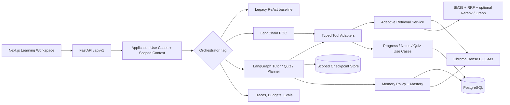
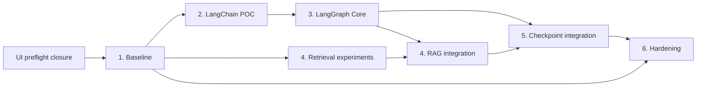

# MASTER PLAN — Self Study Supporter → Personalized AI Learning Agent

**Document owner:** AI/Backend Lead · **Date:** 2026-10-14 · **Version:** 1.0 proposal
**Source of truth for execution:** this folder + actual PR/CI/benchmark artifacts.
**Baseline inspected:** `ManhT005/self-study_supporter`, `feature/ui-learning-workspace`.

## 1. Executive decision

**Vision:** A trustworthy document-first learning assistant that can tutor with citations, create and grade valid quizzes, diagnose gaps, recommend the next step, and remember progress across learning sessions. The platform must be demonstrably better than the legacy ReAct baseline and operationally safe for multiple users.

**Engineering goal:** An AI Engineer portfolio project showing *hypothesis → benchmark → design decision → controlled implementation → ablation → observability → reproducible release*, not a checklist of framework integrations.

**Keep:** Next.js/TypeScript frontend, FastAPI boundary, Python `study_supporter` package, PostgreSQL, Chroma, BGE-M3/1024-dimension indexed vectors, BM25/RRF, four tools, existing owner-bound application services, legacy Streamlit fallback and current CI.

**Replace incrementally:** regex/text ReAct orchestration (not the baseline reference), implicit task state and UI-only quiz state. **Extend:** evidence-grading retrieval, LangGraph workflows, checkpointed execution and typed mastery/memory.

**Never:** silently modify existing vector IDs/dimensions, reinterpret persisted quiz IDs, trust `user_id` from the model or browser for authorization, show raw chain-of-thought, infer facts from absent evidence, or claim online quality from fake-provider tests.

## 2. Current-state audit (read-only; inspected 2026-10-14)

| Area | Observed state | Consequence |
|---|---|---|
| UI | `apps/web` Next.js and `apps/api` FastAPI preview implemented; responsive tests/E2E exist | Do not redesign UI again for AI migration |
| Core | `backend/src/study_supporter/{domain,application,ai,infrastructure,orchestration}` and import boundaries exist | Plug orchestration into application ports, not views |
| Legacy agent | `orchestration/legacy_react/orchestrator.py` parses `Action:`/`Final Answer:` via regex, max 5 iterations | Keep as immutable comparison baseline; replace in flag-driven adapter |
| Tools | `search_docs`, `generate_quiz`, `get_progress`, `save_note` exist; user scope bound during construction | Preserve exact business semantics; implement typed wrappers without widening authority |
| Retrieval | BGE-M3, Chroma Dense + BM25/RRF, per-document evidence with chunk/page/source metadata | Benchmark ranking before adding expensive steps |
| Learning | Quiz generation and progress persistence exist; quiz context can use early chunks | Add topic-specific retrieval and provenance before personalized quiz |
| Eval | `evaluation/eval_runner.py` compares RAG-only / ReAct; runner currently slices first **5** cases | Build versioned ≥100-case dataset, eliminate sampling bias and store structured outputs |
| Persistence | SQL/Chroma store learning artifacts; API sessions and unfinished quiz states are process-memory; ingestion synchronous | Preserve existing data, design checkpoint ownership and restart behavior |
| UI acceptance | Recorded Python 128 tests, web Vitest 12, Playwright desktop/mobile and A11y; **real-provider + restored historical data + rollback + phone signoff pending** | Close migration operational gates independently from AI improvements |
| CI | Quality workflow checks Python, API, frontend, Docker-related validation | Add deterministic agent/eval regression stage; heavy models remain opt-in |

Evidence sources: `docs/architecture/overview.md`, `docs/design/ui-v1/VALIDATION.md`, `docs/reports/repository-consolidation-acceptance.md`, `evaluation/runner.py`, `apps/api/app/learning.py`, `backend/src/study_supporter/orchestration/legacy_react/*`. **Do not interpret earlier acceptance logs as a new CI run.** The current architecture overview has a stale statement that Next.js was not introduced; update it in a small documentation PR.

## 3. Target architecture



**Boundaries:** `apps/api` authenticates and validates → `application` enforces ownership and contracts → orchestration decides next tool/node → infrastructure implements models/vector/DB. `domain`/`ai` pure layers must not import LangChain, LangGraph, DB, HTTP or SDKs. Checkpointer and vendor abstractions belong behind orchestration/infrastructure ports.

**Execution contract (proposed):**

```text
AgentRequest { authenticated_context, thread_id?, intent?, question, active_document_ids,
               mode, idempotency_key?, client_capabilities? }
AgentResult  { answer?, citations[], quiz?, plan?, status, safe_activity[],
               trace_id, thread_id?, usage?, error_code? }
```

There must be no user-controlled field that is treated as authenticated identity. Source/citation IDs come from validated retrieval only. Add response DTOs additively to the existing OpenAPI/TypeScript regeneration workflow.

## 4. Six phases and stage gates

| Phase | Indicative time (2 engineers) | Input / output | Gate to pass |
|---|---|---|---|
| **1. Baseline & Eval** | 1–2 weeks | Freeze legacy, create benchmark and deterministic runner | Reproducible RAG-only/ReAct numbers; no data leakage |
| **2. LangChain POC** | 1 week | Native `create_agent` with four current tools | ≥99% valid structured tool invocations on POC set; no regex path |
| **3. LangGraph Core** | 2–3 weeks | Tutor, Quiz, Planner explicit state/edges, typed outputs | Golden-path and failure-transition tests, loop/timeout bounds |
| **4. Adaptive RAG** | 2–3 weeks | Router, hybrid, optional graph/rerank, evidence grader | Offline retrieval + answer eval improves or earns measured trade-off |
| **5. Memory & Persistence** | 1–2 weeks | Checkpointer, durable thread, account-scoped profile/progress | Resume after restart; 0 cross-user access failures in adversarial suite |
| **6. Hardening** | 1–2 weeks | CI, tracing, quotas, timeout, Docker + rollback | Release checklist, runbook, soak/load and restore drill passed |

**Total provisional calendar:** ~8–13 engineering weeks after UI cutover checks, plus review/bug buffer; re-estimate after Phase 1. Phases 4 and 5 may have design spikes in parallel, but persist graph runs only after checkpoints and transaction policy are complete. No promotion based only on elapsed time.

### Cross-phase dependencies



## 5. Product flows and ownership

| User action | Main orchestration | Persisted evidence | UI expectation |
|---|---|---|---|
| Ask about uploaded document | Tutor graph → retrieval → answer verification | conversation turn, citation IDs, request trace | Cited answer or explicit abstention |
| Ask for practice | Quiz graph → scoped retrieval → structured quiz → validation | quiz attempt and grading | Exactly 4 options, one correct answer, explanation |
| Ask what to study next | Planner graph → mastery + prerequisite DAG + availability | proposed plan / accepted plan / reason | “Why this step” and user approval before plan change |
| Resume learning | checkpoint + authorized thread rehydration | thread turns, versioned state, progress | Continue without exposing other users' work |

Current frontend documents are real “document workspaces,” **not** course enrollment or a full PDF reader. Planner v1 operates on owned documents/topics; persisted course entities and storage of original PDF files are **future features requiring separate ADR/migration**.

## 6. KPI framework — proposed thresholds, not observed facts

**Safety/contract hard gates:** zero cross-user data disclosure in adversarial fixture suite; zero mismatched citations in deterministic test; no tool called without validating schema/permission; no credential or raw thought logs; no invalid quiz accepted.

**Candidate release-quality targets (tune with Phase 1 data):**

| Metric | Definition | Candidate target |
|---|---|---|
| Tool-call validity | Valid schema + authorized dispatch / all attempted calls | ≥99% on structured test set |
| Citation precision | Verified supporting evidence references / cited references | ≥95% on manually labeled set |
| Faithfulness | Human/LLM-judge assessment grounded in document | ≥ baseline; target +5 percentage points when statistically supported |
| Retrieval recall@5 | Relevant distinct chunks in top 5 / all gold relevant chunks, averaged over eligible cases | ≥ baseline; target +5 pp when feasible |
| Quiz structural validity | Valid generated question sets / attempted generations | ≥99% with bounded retry; failures surfaced |
| Resume correctness | Restart/retry cases retaining authorized state and no duplicate effects | 100% scripted cases |
| p95 interactive latency | p95 request duration under declared load / model | ≤1.5× baseline for advanced path unless quality gain justifies |
| Error observability | Failed traces with typed error, route, step and correlation ID | ≥99% |

Report denominator, model/version, hardware, cost/tokens, timeout and confidence intervals. Do not optimize judge scores at the expense of citation validity and privacy.

## 7. Release train and feature flags

- **R0 / UI Preview Closure:** Existing app feature parity, real-provider, historical-data restore, physical-device and Streamlit rollback evidence. No LangChain feature exposed.
- **R1 / AI Evaluation Foundation:** Eval artifacts in CI and reproducible baseline. AI serving unchanged.
- **R2 / LangChain Experimental:** Behind dev/test flag only; `legacy` is rollback.
- **R3 / Stateful Graph Beta:** Tutor → Quiz → Planner released gradually for explicitly enabled test users; evidence-grade fallback.
- **R4 / Adaptive Learning Candidate:** Measured retrieval quality and authorized durable memory.
- **R5 / v1 release:** Ops/reliability gates passed; Streamlit removal is **a separate decision**, not bundled automatically.

Configuration uses explicit `AI_ORCHESTRATOR`, `RAG_STRATEGY`, `MEMORY_MODE`, `TRACE_SAMPLING` plus resource budgets; validate allowed combinations at startup. Never enable experimental modes by accident when flags are unset.

## 8. Responsibility and review (proposed for a small team)

- **AI Lead:** experiments, agent schemas, model/provider capability matrix and AI rollout decision.
- **Backend Engineer:** scoped ports, API, durable persistence, migrations, secure tool execution.
- **Frontend Engineer:** typed API, safe activity UI, citation/quiz/plan interaction and UX regression.
- **Reviewer/QA (can be rotated):** benchmark labeling, privacy adversarial cases, CI and acceptance evidence.

For solo work: keep the same roles as separate checklists and avoid self-approving high-risk privacy and schema changes where possible.

## 9. Critical risks and mitigations

1. **Tool-calling support differs by Ollama/cloud model.** Capability probe per configured model; reject unsupported native-tool mode or flag fallback to legacy; never parse fabricated tool calls from free text.
2. **Cross-user memory leakage.** Derive account identity only from auth; namespace checkpoints by user + thread; test A/B ownership, deletion, backups and cached sessions.
3. **Evidence grading adds latency and false rejects.** Run cheapest retrieval first, rerank selectively, set bounded retry loop, publish ablations.
4. **LLM-as-judge bias.** Gold labels + blind human subset, judge version/prompt locking, agreement and repeated runs.
5. **Concurrent persistence breaks legacy IDs or vector layout.** Additive schema only, Alembic backward-compatibility, snapshot/restore test, no implicit reindex.
6. **UI migration and AI refactor collide.** Freeze API contracts and complete UI cutover gates; small PRs per vertical slice with feature flags.

## 10. Definition of done for any phase

- Reproducible command + CI/offline result; explicit model requirements if online.
- Scoped code changes with ADR or updated docs, affected contracts/typed client regenerated.
- Positive/negative tests, ownership/access tests, timeout/retry and corrupted-input cases.
- Benchmark report (including degradations) and environment manifest; trace IDs link evidence.
- Migration and restore/rollback steps where data shape changes.
- Maintainer approval; link PR + commit SHA and status in phase report. **A plan file alone never proves completion.**

**Next:** Read [`00_BASELINE_EVALUATION.md`](00_BASELINE_EVALUATION.md) and execute the first checklist before framework work.
